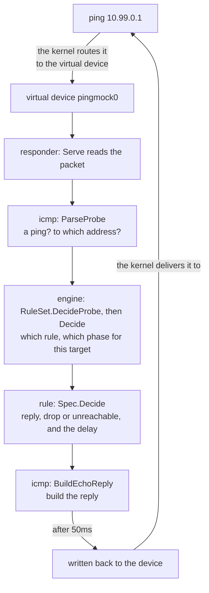

# A tour of the pingmock code

English | [中文](architecture.zh-CN.md)

This document helps you read the pingmock code: what it is made of, how a ping is handled step by step, and in which order to read it. The code is about 6,600 lines without tests; ping is the heart of it, and read in the order below, the ping path takes an hour or two. TCP connections and DNS queries follow the same pattern and are described after it.

If addresses, packets, TCP or DNS are new to you, read [Network basics](basics.md) first: it explains them with diagrams.

## The idea in one paragraph

pingmock creates a **virtual network device** (a TUN device) and routes the addresses it mocks to it. From then on, whenever a program pings one of those addresses, the kernel hands the ping packet to pingmock. pingmock decides how to answer from the rules (reply after some delay, drop it, or report the destination unreachable), builds the answer itself and writes it back to the device, and the kernel delivers it to the program that pinged.

The mocked "hosts" do not exist: every answer is made up by pingmock.

## Map of the repository

```
main.go                   entry point, a few lines that call internal/app
internal/
  app/                    the command: flags, starting up, exec       ← puts the packages together
  tun/                    the virtual device, its addresses and routes   ┐
  responder/              the main loop: read a packet, answer it        │ the packages a
  icmp/                   packets: parse ping requests, build answers    │ ping goes through,
  engine/                 decisions: how to answer each target, stats    │ in order
  rule/                   rules: what a rule is and how it is written    ┘
  api/                    the HTTP API that changes rules while running
  config/                 the YAML configuration file
  dns/                    the DNS server pingmock exec runs for its command, with DNS rules
client/                   Go client for the API, for tests (the only public package)
test/                     end-to-end and compatibility checks
examples/                 programs and tests to copy from, one per language or tool
docs/                     these documents
contrib/, scripts/        the AppArmor profile; the release notes script
```

Packages under `internal/` are for this project only; `client/` is public and may be imported by others.

## The journey of one ping

With the rule `10.99.0.1=50ms`, a program runs `ping 10.99.0.1`:



In the code:

1. **Read**: [`Responder.Serve`](../internal/responder/responder.go) is the main loop of the program. It reads packets from the device and passes each to `handle`.
2. **Parse**: [`ParseProbe`](../internal/icmp/probe.go) checks what the packet is: here a ping (ICMP over IPv4 or ICMPv6 over IPv6), whose source, destination, TTL, identifier and sequence number it extracts. It also recognizes TCP segments and UDP probes; anything else is ignored.
3. **Decide**: [`RuleSet.DecideProbe`](../internal/engine/path.go) sends a ping to a target without a path on to [`RuleSet.Decide`](../internal/engine/ruleset.go), which finds the rule for the destination (the most specific prefix wins), works out which phase of the rule this target is in, and calls [`Spec.Decide`](../internal/rule/spec.go) for the outcome: reply, drop or unreachable, and the delay.
4. **Build**: depending on the outcome, [`BuildEchoReply`](../internal/icmp/icmp.go) builds the reply, which is the request with its addresses swapped and its type changed, or [`BuildUnreachable`](../internal/icmp/icmp.go) builds a destination unreachable error.
5. **Record**: [`Responder.record`](../internal/responder/responder.go) adds the request to the history that `GET /history` returns.
6. **Write back later**: `Serve` uses `time.AfterFunc` to write the answer to the device after the delay. Each answer has its own timer, so a slow answer never holds up other requests; answers without a delay are written at once, in order.

The ping program measures the round trip and finds the configured 50ms.

This is what happens **inside** pingmock. For how the request travels from ping through the kernel to pingmock0, and the reply back, see [The round trip of one ping](packet-path.md).

## Connections and DNS queries

TCP and DNS rules reuse everything above: the same `Spec`, `Phase` and `Scenario`, parsed with the settings of their protocol, the same `advance`, and a random stream per target derived from the seed. Each protocol keeps its own rules and per-target state in the `RuleSet`, so the seeded sequences of pings never move.

**A connection attempt** (`-tcp 10.99.0.1:5432=...`) arrives on the device like a ping:

1. [`ParseProbe`](../internal/icmp/probe.go) recognizes a TCP SYN (`Kind` `TCP`), or another segment of a connection (`Kind` `Segment`).
2. For a SYN, [`RuleSet.DecideTCP`](../internal/engine/tcp.go) finds the rule for the address and port (the most specific prefix, then a rule for the port over one for every port) and decides as for a ping: `SynAck`, `Refused`, `Drop` or `Unreachable`. A SYN the client's kernel sends again for the same attempt gets the same answer, from a cache keyed by addresses, ports and initial sequence number.
3. [`BuildSynAck`](../internal/icmp/probe.go) or [`BuildRST`](../internal/icmp/probe.go) builds the answer; the client's kernel completes the handshake.
4. Under `after=close` or `after=reset`, or a rule that sends data, the accepted connection is remembered, and [`RuleSet.DecideSegment`](../internal/engine/tcp.go) answers its later segments: a FIN on the handshake's last ACK, or a reset on the first data, at most once per connection; with `send=`, `reply=` or `limit=`, `talk` also acknowledges the client's data and sends the bytes in segments of 536 bytes. Acknowledgments go out at once; data, FINs and resets go through a queue per connection in the responder, so that nothing overtakes data held back by `wait=`.

**A UDP datagram** to an address and port with a UDP rule goes the same way as a SYN, without the cache: [`RuleSet.DecideUDP`](../internal/engine/udp.go) decides `Refused` (answered with ICMP port unreachable), `Unreachable` or `Drop`, and with a path the hops answer first.

**A DNS query** never reaches the device. Under `pingmock exec`, the command's `resolv.conf` points at a small DNS server in the [`dns`](../internal/dns/dns.go) package, which the child starts in [`serveDNS`](../internal/app/names_linux.go):

1. `Server.Serve` (UDP) and `Server.ServeTCP` answer each query on its own goroutine.
2. If the name has a DNS rule, `Server.Rule` asks [`RuleSet.DecideDNS`](../internal/engine/dns.go), which keeps phases per name and query type: an error (`NXDomain`, `ServFail`), no answer (`Drop`), or the usual answer after a delay.
3. The usual answer comes from the table of mocked names, or from the host's resolver, through a socket pair to the parent process, which kept the host's network ([`StreamForwarder`](../internal/dns/dns.go) and `ServeRelay`).

## Core concepts

These types are the key to the code. They live in `rule` and `engine`:

| Concept | Code | Meaning |
|---|---|---|
| **Spec** | [`rule.Spec`](../internal/rule/spec.go) | How to answer **one** request: delay, jitter, loss or a loss pattern, unreachable or not, TTL; for TCP rules also `refuse`, `after`, `send`, `reply`, `limit` and `wait`, for DNS rules `nxdomain` and `servfail`. `delay=50ms,loss=5%` is a Spec |
| **Phase** | [`rule.Phase`](../internal/rule/scenario.go) | A Spec with a length: a duration (`for 10s`) or a number of requests (`for 5 pings`) |
| **Scenario** | [`rule.Scenario`](../internal/rule/scenario.go) | A sequence of phases, such as `30ms for 10 pings; timeout`. A plain rule is a scenario with one endless phase |
| **Outcome** | [`rule.Outcome`](../internal/rule/outcome.go) | What happens to a request: `Reply`, `Drop` or `Unreachable`; for paths also `TimeExceeded`, `PortUnreachable` and `SynAck`, and for TCP rules `Refused`, `Closed` and `Reset` for connections they accepted with `after=`, and `Sent` for their `send=` and `reply=`; for DNS rules `NXDomain` and `ServFail` |
| **RuleSet** | [`engine.RuleSet`](../internal/engine/ruleset.go) | The installed rules, and **the state of each target address**: its phase, how many requests it got in that phase, and its own random source; likewise for each address and port of TCP rules ([`tcp.go`](../internal/engine/tcp.go)) each address and port of UDP rules ([`udp.go`](../internal/engine/udp.go)), and each name and query type of DNS rules ([`dns.go`](../internal/engine/dns.go)) |
| **Decision** | [`engine.Decision`](../internal/engine/ruleset.go) | What `RuleSet.DecideProbe` and `Decide` return: the outcome, the delay, and the rule and phase that applied |
| **History** | [`engine.History`](../internal/engine/history.go) | Recent requests, in a fixed-size ring buffer |

Two design choices that are easy to wonder about:

- **Why does each target have its own random source?** So that `-seed` is reproducible: with a given seed, the drops for one address do not change when requests to other addresses come in between. The source is derived from the seed and the address; see [`RuleSet.rngFor`](../internal/engine/ruleset.go).
- **How do phases change?** Whenever a request comes in, [`advance`](../internal/engine/ruleset.go) first checks whether the current phase has ended (its time is up or it got its requests), moves on if so, and then the request is answered by the current phase.

## Where rules come from

Rules can be written in three places, which end up in the same parsing code:

```
-rule 10.99.0.1=50ms on the command line  ─→  rule.ParseScenario (the text form)
a YAML configuration file                 ─→  config.Load ─→ converted to JSON ─┐
the JSON body of an HTTP API request      ──────────────────────────────────────┴─→  Scenario.UnmarshalJSON
```

YAML configuration is converted to JSON first ([`yamlToJSON`](../internal/config/yaml.go)), so configuration files and the HTTP API share one JSON decoding and validation ([`json.go`](../internal/rule/json.go)) instead of two. Before converting, `yamlToJSON` checks for the most common mistakes so it can report their line.

## Starting up

```
main.go: main
  └─ app.Main                    dispatches on the first argument
       ├─ runServer              sudo pingmock [flags]
       │    ├─ parseSettings     flags → configuration file → validation, giving settings
       │    └─ start             device → addresses → rules → API → main loop
       └─ runExec                pingmock exec [flags] -- CMD
```

[`parseSettings`](../internal/app/settings.go) gives precedence to **flags on the command line, then the configuration file, then defaults**. When [`start`](../internal/app/instance.go) returns, pings are answered and the API is listening.

## pingmock exec

`pingmock exec` needs no root thanks to Linux **namespaces**:

```
your terminal
  └─ pingmock exec (the parent, runExec)
       │  creates new user, network and PID namespaces and starts itself again inside them
       └─ pingmock (the child, runExecChild; root and process 1 in the new namespaces)
            ├─ start: creates the virtual device in this private network
            └─ CMD (for example ./my-app), with PINGMOCK_API pointing at the API
```

- The **user namespace** gives an unprivileged user root inside it, and only there, so it can create the device.
- The **network namespace** is a separate set of devices and routes, so the host is not affected.
- The **PID namespace** makes the child process 1. When it exits, the kernel ends every process in the namespace, so nothing is left behind.

The code is in [`exec_linux.go`](../internal/app/exec_linux.go): [`runExec`](../internal/app/exec_linux.go) is the parent and [`runExecChild`](../internal/app/exec_linux.go) the child, which recognizes itself by the special first argument `__pingmock-exec-child`.

## Suggested reading order

1. **[`rule/doc.go`](../internal/rule/doc.go)**: what rules look like and which concepts there are
2. **`Spec.Decide`** in [`rule/spec.go`](../internal/rule/spec.go): how a rule decides the outcome of a request, about 40 lines
3. **`RuleSet.DecideProbe`** in [`engine/path.go`](../internal/engine/path.go), then **`RuleSet.Decide` and `advance`** in [`engine/ruleset.go`](../internal/engine/ruleset.go): how each target gets its rule and phase
4. **[`responder/responder.go`](../internal/responder/responder.go)**: the main loop that ties these together, about 150 lines
5. **[`icmp/icmp.go`](../internal/icmp/icmp.go)**: the packet formats; skip it at first if network protocols do not interest you, or read [Inside the packets](packets.md), which goes through every field it handles, byte by byte
6. **[`app/`](../internal/app/)**: flags, starting up and exec
7. **[`engine/tcp.go`](../internal/engine/tcp.go)**, then **[`engine/dns.go`](../internal/engine/dns.go)** and **[`dns/dns.go`](../internal/dns/dns.go)**: the other protocols, once the ping path is clear

## Where the tests are

- **Unit tests**: the `*_test.go` files next to each package; no root needed, run `make test`. The responder tests feed packets to a fake device, and the engine tests use a fake clock moved by hand.
- **End-to-end checks**: in [`test/`](../test/), with the real `ping`, curl, bash's `/dev/tcp`, getent and Python; run `make e2e`, `make e2e-exec`, `make e2e-compat` and `make e2e-docker`.

## Where to make common changes

| To do this | Change |
|---|---|
| Add a setting to rules | `Spec`, `ParseSpec`, `String` and `Decide` in `rule/spec.go`, and the JSON form in `rule/json.go`; `validateFor` says which protocols may use it |
| Add a protocol | a `proto` in `rule/spec.go` with its scenario type, a state file in `engine/` like `tcp.go`, its key in `Snapshot`, `SaveBaseline`, `Reset` and `ResetStats`, a flag, a configuration section and API paths as for TCP |
| Add an outcome (duplicate replies, say) | `rule/outcome.go`, `Decide` in `rule/spec.go`, a builder in `icmp/`, and `handle` in `responder` |
| Add an HTTP API endpoint | `api/api.go`: a line in the routing table in `NewHandler` and a method; the matching method in `client/` |
| Add a configuration field | `Config` in `config/config.go`, `knownFields` in `config/yaml.go`, and `applyConfig` in `app/settings.go` |
| Add a command-line flag | `defineFlags` and `resolve` in `app/settings.go` |

When you change behavior that users see, change both languages together: `README.md` and `README.zh-CN.md`, every document in `docs/`, and both READMEs of every example.
