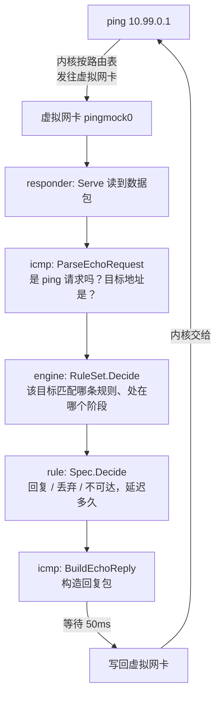

# pingmock 代码导读

[English](architecture.md) | 中文

这份文档帮你读懂 pingmock 的代码：它由哪些模块组成、一个 ping 请求是怎样一步步被处理的，以及应该按什么顺序阅读。全部代码约 6600 行（不含测试），核心是 ping；按下面的顺序读，ping 的处理路径一两个小时就能读完。TCP 连接和 DNS 查询沿用同样的模式，在它之后介绍。

如果地址、数据包、TCP 或 DNS 对你来说还比较陌生，请先读[网络基础](basics.zh-CN.md)，那里配着示意图讲解了这些概念。

## 一句话原理

pingmock 创建一块**虚拟网卡**（TUN 设备），把要模拟的地址都路由到这块网卡上。之后任何程序 ping 这些地址，内核都会把 ping 请求的数据包交给 pingmock；pingmock 按规则决定怎么回应（多久之后回复、丢弃，还是返回"目标不可达"），自己构造回复包写回网卡，内核再把它交还给发 ping 的程序。

所以，被模拟的"主机"其实并不存在，回复全是 pingmock 伪造的。

## 目录地图

```
main.go                   程序入口，只有几行，调用 internal/app
internal/
  app/                    命令行：解析参数、启动、exec 模式      ← 把各模块组装起来
  tun/                 *  虚拟网卡：创建设备、设置地址和路由
  responder/           *  主循环：读取数据包，回应，写回
  icmp/                *  数据包：解析 ping 请求，构造回复
  engine/              *  决策：每个目标该怎么回应，统计和历史
  rule/                *  规则：一条规则是什么，怎么书写
  api/                    HTTP 控制接口：运行中修改规则
  config/                 YAML 配置文件
  dns/                    pingmock exec 为命令运行的 DNS 服务，执行 DNS 规则
client/                   给 Go 测试用的 API 客户端（唯一公开的包）
test/                     端到端测试脚本
```

带 `*` 的几个模块，就是一个 ping 请求从上到下依次经过的。

`internal/` 下的包只供本项目使用；`client/` 是公开的，其他项目可以引用。

## 一个 ping 请求的旅程

假设规则是 `10.99.0.1=50ms`，有程序执行了 `ping 10.99.0.1`：



对应到代码：

1. **读取**：[`Responder.Serve`](../internal/responder/responder.go) 是整个程序的主循环，不断从网卡读取数据包，交给 `handle` 处理。
2. **解析**：[`ParseEchoRequest`](../internal/icmp/icmp.go) 检查这是不是一个 ping 请求（IPv4 的 ICMP 或 IPv6 的 ICMPv6），并取出源地址、目标地址、序号。其他数据包直接忽略。
3. **决策**：[`RuleSet.Decide`](../internal/engine/ruleset.go) 找到目标地址匹配的规则（最精确的网段优先），确定这个目标当前处在规则的哪个阶段，再调用 [`Spec.Decide`](../internal/rule/spec.go) 得出结果：回复、丢弃还是不可达，以及延迟多久。
4. **构造**：根据结果，[`BuildEchoReply`](../internal/icmp/icmp.go) 构造回复包，或者 [`BuildUnreachable`](../internal/icmp/icmp.go) 构造"目标不可达"错误包。回复包就是把请求包的源地址和目标地址对调，再改一下类型字段。
5. **记录**：[`Responder.record`](../internal/responder/responder.go) 把这次请求写进历史记录，供 `GET /history` 查询。
6. **延迟写回**：`Serve` 用 `time.AfterFunc` 在设定的延迟之后把回复包写回网卡。每个回复各自计时，所以一个慢回复不会挡住其他请求。

ping 程序收到回复时计算往返时间，得到的就是设定的 50ms。

这里讲的是 pingmock **内部**的处理。请求是怎样从 ping 经过内核到达 pingmock0、应答又是怎样回到 ping 的，参见[一个 ping 的往返之旅](packet-path.zh-CN.md)。

## 连接和 DNS 查询

TCP 和 DNS 规则沿用上面的一切：同样的 `Spec`、`Phase`、`Scenario`（按各自协议允许的设置解析），同样的 `advance`，以及由种子派生、每个目标各自的随机流。每种协议在 `RuleSet` 里有自己的规则表和目标状态，所以 ping 的种子序列不会变。

**一次连接请求**（`-tcp 10.99.0.1:5432=...`）和 ping 一样到达网卡：

1. [`ParseProbe`](../internal/icmp/probe.go) 识别出 TCP SYN（`Kind` 为 `TCP`），或者连接上的其他报文（`Kind` 为 `Segment`）。
2. 对 SYN，[`RuleSet.DecideTCP`](../internal/engine/tcp.go) 找到这个地址和端口的规则（先比网段谁更精确，再比带端口的优先），像 ping 一样决定结果：`SynAck`、`Refused`、`Drop` 或 `Unreachable`。客户端内核为同一次连接重发的 SYN 得到同样的回应，靠的是按地址、端口和初始序号记下的缓存。
3. [`BuildSynAck`](../internal/icmp/probe.go) 或 [`BuildRST`](../internal/icmp/probe.go) 构造回应，客户端内核完成握手。
4. 在 `after=close` 或 `after=reset` 下，接受的连接会被记住，[`RuleSet.DecideSegment`](../internal/engine/tcp.go) 回应它之后的报文：在握手的最后一个 ACK 上发 FIN，或者在第一段数据上发 RST，每个连接最多一次。没有延迟的回应在读循环里按顺序写出，所以 RST 不会抢在它前面的 FIN 之前。

**一次 DNS 查询**根本不经过网卡。在 `pingmock exec` 下，命令的 `resolv.conf` 指向 [`dns`](../internal/dns/dns.go) 包里的一个小 DNS 服务，由子进程在 [`serveDNS`](../internal/app/names_linux.go) 中启动：

1. `Server.Serve`（UDP）和 `Server.ServeTCP` 为每个查询单独起一个 goroutine 回答。
2. 域名有 DNS 规则时，`Server.Rule` 询问 [`RuleSet.DecideDNS`](../internal/engine/dns.go)，它按（域名, 查询类型）记录阶段：回错误（`NXDomain`、`ServFail`）、不回应（`Drop`），或者延迟之后给出通常的回复。
3. 通常的回复来自模拟域名的表，或者经过一对套接字交给仍在宿主机网络里的父进程，由它询问宿主机的解析器（[`StreamForwarder`](../internal/dns/dns.go) 和 `ServeRelay`）。

## 核心概念

这几个类型是理解代码的关键，都在 `rule` 和 `engine` 两个包里：

| 概念 | 代码 | 说明 |
|---|---|---|
| **规则** | [`rule.Spec`](../internal/rule/spec.go) | 怎样回应**一个**请求：延迟、抖动、丢包率或丢包模式、是否返回不可达。`delay=50ms,loss=5%` 就是一个 Spec |
| **阶段** | [`rule.Phase`](../internal/rule/scenario.go) | 一个 Spec 加上持续多久（`for 10s`）或持续几个请求（`for 5 pings`） |
| **场景** | [`rule.Scenario`](../internal/rule/scenario.go) | 若干阶段组成的序列，比如 `30ms for 10 pings; timeout`。普通规则就是只有一个阶段、永不结束的场景 |
| **结果** | [`rule.Outcome`](../internal/rule/outcome.go) | 一个请求的结局：`Reply`（回复）、`Drop`（丢弃）、`Unreachable`（不可达）；路径还有 `TimeExceeded`、`PortUnreachable`、`SynAck`，TCP 规则还有 `Refused`（拒绝），以及用 `after=` 关闭或重置已接受连接时的 `Closed`、`Reset`；DNS 规则还有 `NXDomain`、`ServFail` |
| **规则集** | [`engine.RuleSet`](../internal/engine/ruleset.go) | 所有已安装的规则，以及**每个目标地址各自的状态**：处在哪个阶段、阶段里已经收到几个请求、自己的随机数生成器；TCP 规则的每个地址和端口（[`tcp.go`](../internal/engine/tcp.go)）、DNS 规则的每个域名和查询类型（[`dns.go`](../internal/engine/dns.go)）也一样 |
| **决策** | [`engine.Decision`](../internal/engine/ruleset.go) | `RuleSet.Decide` 的返回值：结果、延迟、匹配的规则和阶段 |
| **历史** | [`engine.History`](../internal/engine/history.go) | 最近请求的记录，固定大小的环形缓冲区 |

两个容易困惑的设计：

- **为什么每个目标有自己的随机数生成器？** 为了让 `-seed` 可复现：同一个种子下，某个地址的丢包序列不会因为其他地址的请求穿插进来而改变。随机数生成器由种子和地址共同决定，见 [`RuleSet.rngFor`](../internal/engine/ruleset.go)。
- **阶段是怎么切换的？** 每次请求到来时，[`advance`](../internal/engine/ruleset.go) 先检查当前阶段是否已经结束（时间到了或请求数够了），结束了就进入下一个阶段，再按新阶段的规则回应。

## 规则的三种来源

规则可以写在三个地方，最后都汇集到同一套解析代码：

```
-rule 10.99.0.1=50ms    ─→  rule.ParseScenario                        命令行的文本
pingmock.yaml           ─→  config.Load ─→ yamlToJSON ─┐              YAML 配置文件
PUT /rules {...}        ───────────────────────────────┴─→  Scenario.UnmarshalJSON     HTTP API 的 JSON 请求体
```

YAML 配置先被转换成 JSON（[`yamlToJSON`](../internal/config/yaml.go)），这样 YAML 配置和 HTTP API 共用同一套 JSON 解析和校验逻辑（[`json.go`](../internal/rule/json.go)），不需要写两遍。转换之前，`yamlToJSON` 会先检查最常见的错误，以便报告出错的行号。

## 启动流程

```
main.go: main
  └─ app.Main                    根据第一个参数分发
       ├─ runServer              普通模式：sudo pingmock [参数]
       │    ├─ parseSettings     解析参数 → 读配置文件 → 校验，得到 settings
       │    └─ start             创建网卡 → 设置地址 → 安装规则 → 启动 API → 启动主循环
       └─ runExec                exec 模式：pingmock exec [参数] -- 命令
```

[`parseSettings`](../internal/app/settings.go) 的优先级是：**命令行参数 > 配置文件 > 默认值**。[`start`](../internal/app/instance.go) 返回时，pingmock 已经可以回应 ping，API 也已经在监听。

## exec 模式

`pingmock exec` 不需要 root，靠的是 Linux 的**命名空间**：

```
你的终端
  └─ pingmock exec（父进程，[runExec]）
       │  创建新的 用户 + 网络 + PID 命名空间，然后在里面重新启动自己
       └─ pingmock（子进程，[runExecChild]，在新命名空间里是 root、是 1 号进程）
            ├─ start：在这个独立的网络里创建虚拟网卡
            └─ 被测命令（例如 ./my-app），环境变量 PINGMOCK_API 指向 API
```

- **用户命名空间**让普通用户在里面拥有 root 权限，但只对这个命名空间有效，所以可以创建网卡。
- **网络命名空间**是一套独立的网卡和路由，所以不影响宿主机。
- **PID 命名空间**让子进程成为 1 号进程。它退出时，内核会结束命名空间里的所有进程，所以不会有残留。

代码在 [`exec_linux.go`](../internal/app/exec_linux.go)：[`runExec`](../internal/app/exec_linux.go) 是父进程，[`runExecChild`](../internal/app/exec_linux.go) 是子进程。子进程通过一个特殊的第一个参数 `__pingmock-exec-child` 识别自己。

## 建议的阅读顺序

1. **[`rule/doc.go`](../internal/rule/doc.go)**：先看规则长什么样，有哪几个概念
2. **[`rule/spec.go`](../internal/rule/spec.go)** 中的 `Spec.Decide`：一条规则如何决定一个请求的结果，不到 30 行
3. **[`engine/ruleset.go`](../internal/engine/ruleset.go)** 中的 `RuleSet.Decide` 和 `advance`：如何为每个目标选择规则和阶段
4. **[`responder/responder.go`](../internal/responder/responder.go)**：主循环，把上面几步串起来，不到 100 行
5. **[`icmp/icmp.go`](../internal/icmp/icmp.go)**：数据包的格式细节。如果不关心网络协议，可以先跳过；想深入了解的话，[数据包详解](packets.zh-CN.md)逐字节讲解了它处理的每个字段
6. **[`app/`](../internal/app/)**：参数解析、启动和 exec 模式
7. **[`engine/tcp.go`](../internal/engine/tcp.go)**，然后是 **[`engine/dns.go`](../internal/engine/dns.go)** 和 **[`dns/dns.go`](../internal/dns/dns.go)**：理解了 ping 的路径之后，再看其他协议

## 测试在哪里

- **单元测试**：每个包旁边的 `*_test.go`，不需要 root，运行 `make test`。responder 的测试用一个假的网卡喂数据包，engine 的测试用一个可以手动拨动的假时钟
- **端到端测试**：[`test/`](../test/) 目录下，用真实的 `ping`、curl、bash 的 `/dev/tcp`、getent 和 Python 验证，运行 `make e2e`、`make e2e-exec`、`make e2e-compat`、`make e2e-docker`

## 常见的修改改哪里

| 想做的事 | 要改的地方 |
|---|---|
| 规则新增一个设置 | `rule/spec.go` 的 `Spec`、`ParseSpec`、`String`、`Decide`，以及 `rule/json.go` 的 JSON 写法；`validateFor` 决定哪些协议可以用它 |
| 新增一种协议 | `rule/spec.go` 加一个 `proto` 和对应的场景类型，`engine/` 里仿照 `tcp.go` 加状态文件，在 `Snapshot`、`SaveBaseline`、`Reset`、`ResetStats` 里加上它，再仿照 TCP 加参数、配置段和 API 路径 |
| 新增一种结果（比如重复回复） | `rule/outcome.go`，`rule/spec.go` 的 `Decide`，`icmp/` 构造对应的包，`responder` 的 `handle` |
| HTTP API 新增接口 | `api/api.go`：`NewHandler` 的路由表加一行，再加一个方法；`client/` 加对应的方法 |
| 配置文件新增字段 | `config/config.go` 的 `Config`，`config/yaml.go` 的 `knownFields`，`app/settings.go` 的 `applyConfig` |
| 新增命令行参数 | `app/settings.go` 的 `defineFlags` 和 `resolve` |

修改用户能看到的行为时，记得同时更新 `README.md` 和 `README.zh-CN.md`。
