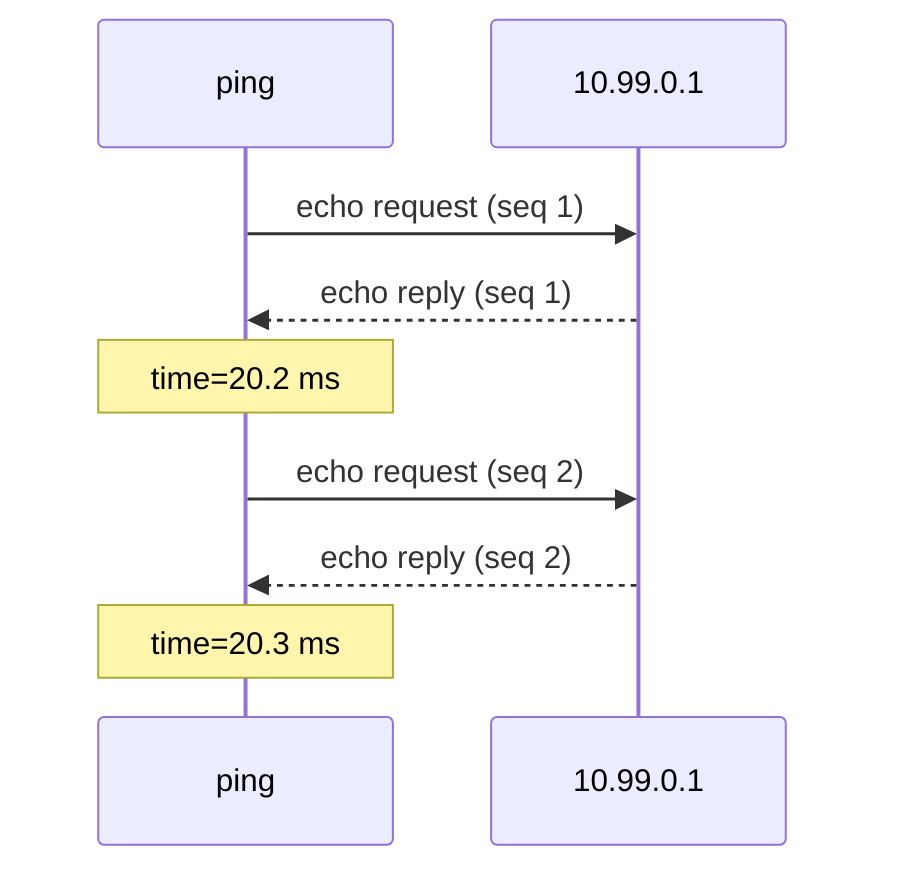
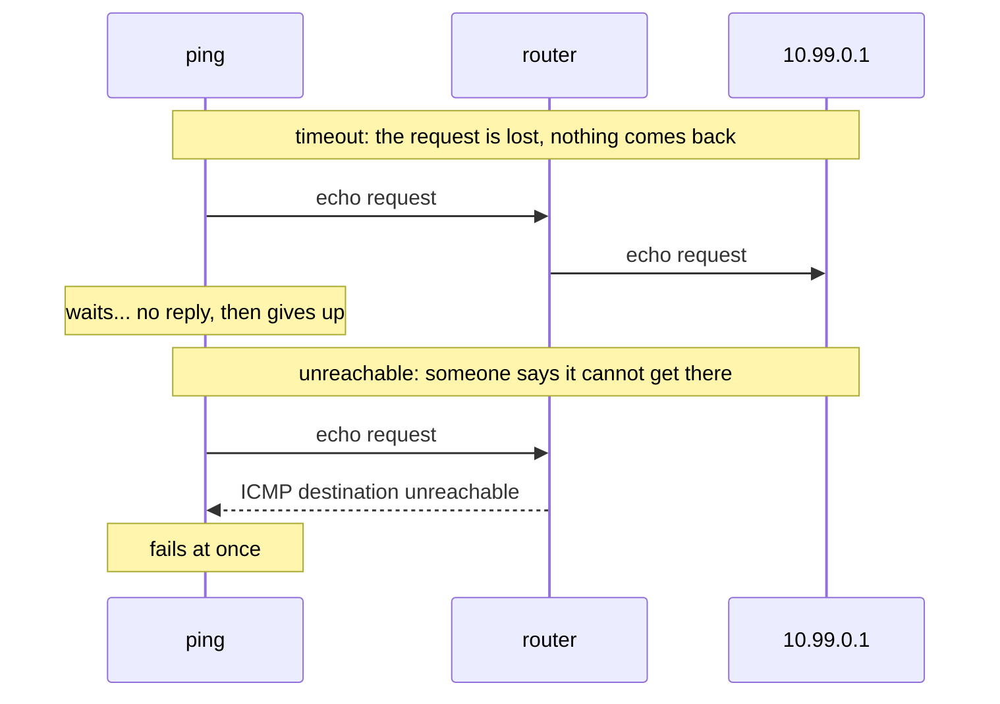
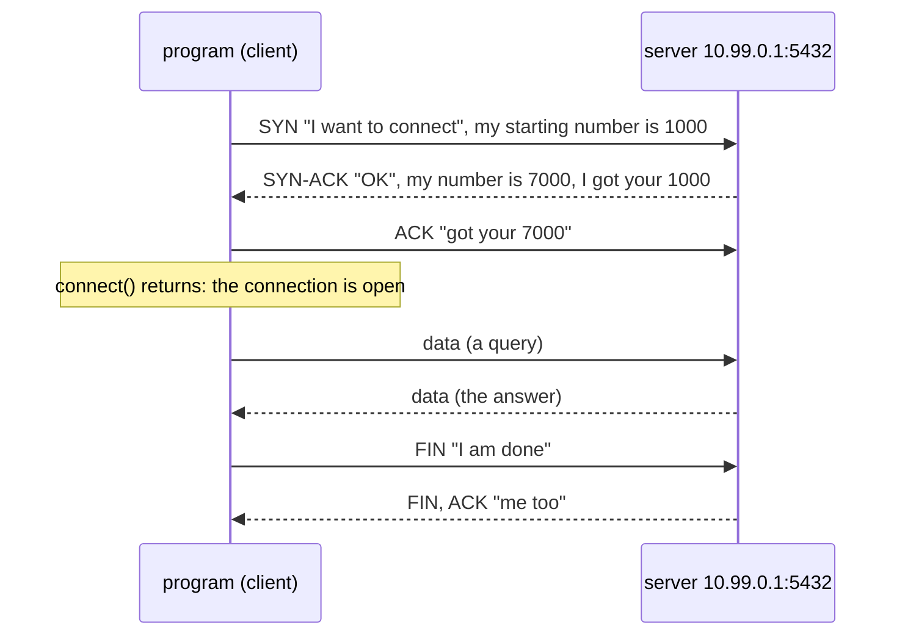
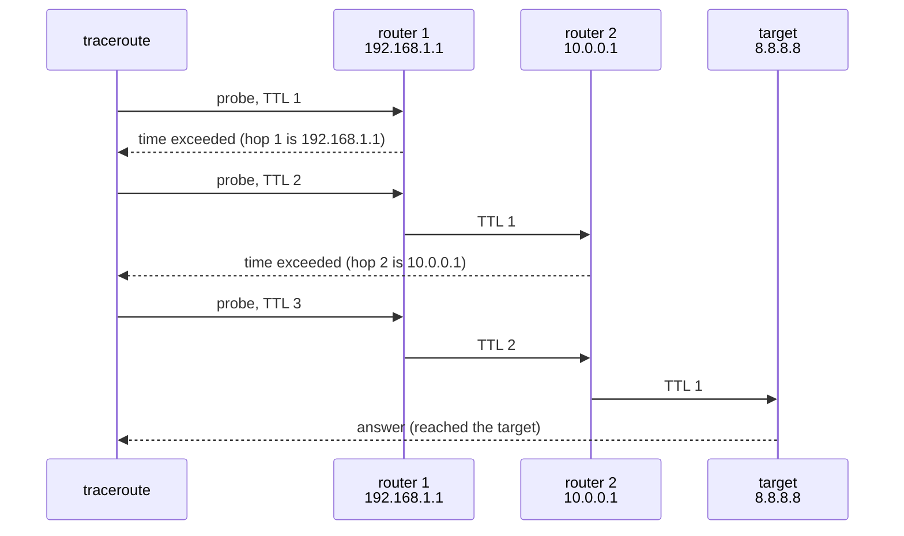
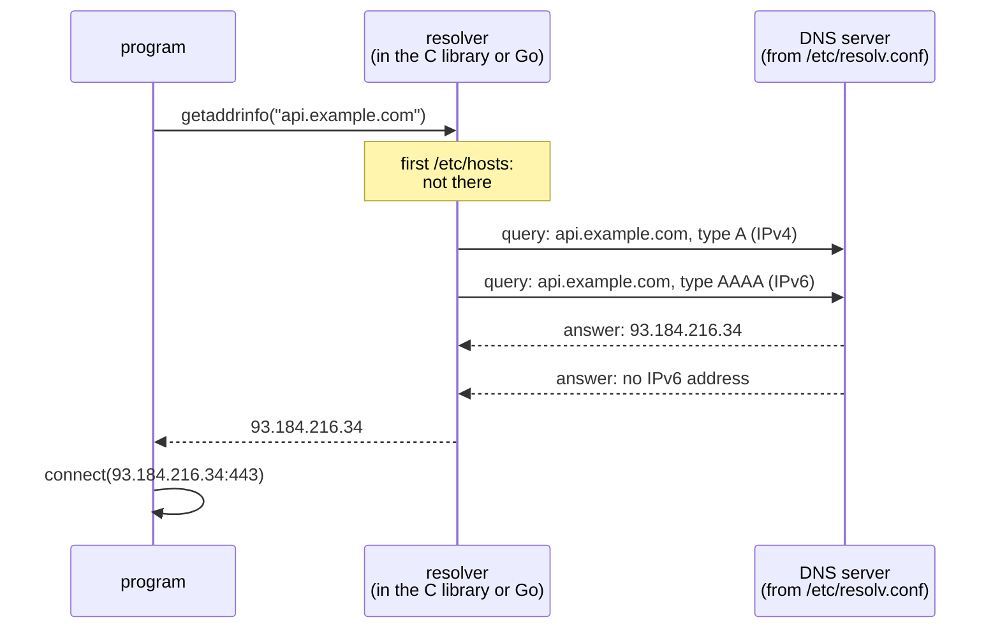
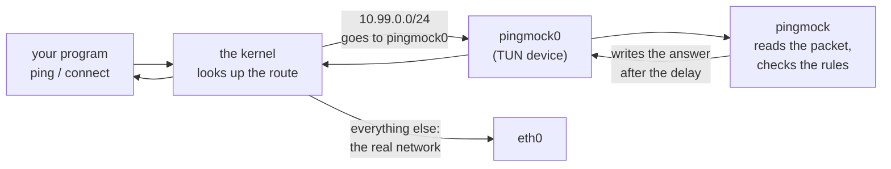
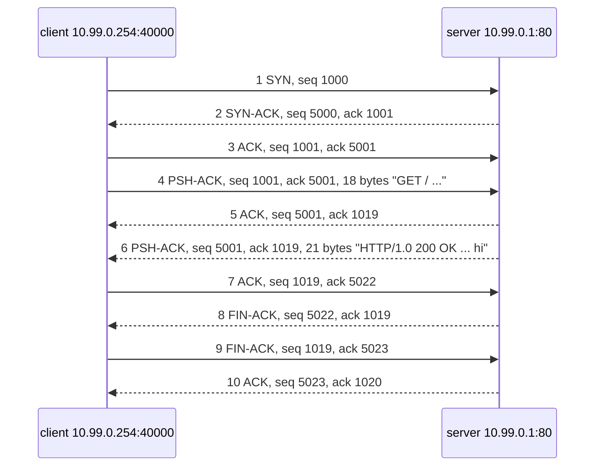

# Network basics for pingmock

English | [中文](basics.zh-CN.md)

This page explains the networking that pingmock relies on, for readers who write programs but have never looked inside a network packet. It covers what an address and a port are, what ping, a TCP connection and a DNS lookup actually send, and how pingmock gets in the middle to fake the answers. Each part ends with what it means for pingmock. Read it in order the first time; afterwards, [the glossary](#glossary) at the end is enough. Section 9 then reads a TCP conversation, a ping and a DNS lookup byte by byte.

Once this page makes sense, [the README](../README.md) shows how to use pingmock, [Inside the packets](packets.md) takes real packets apart byte by byte, and [the code tour](architecture.md) shows how pingmock is built.

## 1. Addresses, subnets and ports

Every machine on a network has an **IP address**, such as `10.99.0.1` (IPv4, four numbers from 0 to 255) or `fd99::1` (IPv6, longer, written in hexadecimal). Data travels in **packets**, and every packet carries the address it comes from and the address it goes to.

A **subnet** is a range of addresses, written as a first address and a number of fixed bits: `10.99.0.0/24` means the first 24 bits (the first three numbers) are fixed, so it covers `10.99.0.0` to `10.99.0.255`. pingmock uses this range by default for its pretend hosts; nothing real uses it.

One machine runs many programs, so an address is not enough to say which program a packet is for. A **port**, a number from 1 to 65535, picks the program: a web server listens on port 443 (HTTPS) or 80 (HTTP), PostgreSQL on 5432. `10.99.0.1:5432` means "port 5432 at 10.99.0.1".

```
             10.99.0.1                 the machine
   ┌──────────────────────────┐
   │  port 80    web server   │
   │  port 5432  database     │        the program on it
   │  port 22    SSH          │
   └──────────────────────────┘
```

Ping has no ports: it talks to the machine itself.

**For pingmock**: rules are written for addresses (`-rule 10.99.0.1=50ms`), for subnets (`-rule 10.99.0.0/24=timeout`), and for TCP also for ports (`-tcp 10.99.0.1:5432=refuse`).

## 2. Packets are layered

A packet is a series of bytes, made of nested parts. Each layer has a **header**, a few bytes in a fixed layout, followed by what it carries:

```
┌─────────────────┬──────────────────────┬────────────────────────┐
│    IP header    │   ICMP, TCP or UDP   │          data          │
│    20 bytes     │        header        │  (the actual content)  │
│ from, to, what  │   type or ports...   │                        │
│  it carries...  │                      │                        │
└─────────────────┴──────────────────────┴────────────────────────┘
```

- The **IP header** says where the packet comes from and goes to, and what it carries: protocol 1 is ICMP (ping), 6 is TCP, 17 is UDP (DNS uses UDP).
- The next header belongs to that protocol: ICMP says what kind of message it is, TCP and UDP give the ports.
- The data is whatever the program sends: a web page, a database query.

The IPv4 header, as RFCs draw it, 32 bits (4 bytes) per row:

```
 0                   1                   2                   3
 0 1 2 3 4 5 6 7 8 9 0 1 2 3 4 5 6 7 8 9 0 1 2 3 4 5 6 7 8 9 0 1
+-------+-------+---------------+-------------------------------+
|Version|  IHL  |      TOS      |          Total length         |
+-------+-------+---------------+-----+-------------------------+
|        Identification         |Flags|     Fragment offset     |
+---------------+---------------+-----+-------------------------+
|      TTL      |   Protocol    |        Header checksum        |
+---------------+---------------+-------------------------------+
|                        Source address                         |
+---------------------------------------------------------------+
|                      Destination address                      |
+---------------------------------------------------------------+
```

The fields that matter here: **Protocol** (what follows), **Source** and **Destination address**, and **TTL**, a counter every router lowers by one, which traceroute uses (section 6).

**For pingmock**: it reads every packet sent to the addresses it mocks, looks at these headers to recognize pings and connection attempts, and writes back answers built byte by byte. [Inside the packets](packets.md) does this with real packets.

## 3. Ping: ICMP echo

`ping 10.99.0.1` sends an **echo request**, a small ICMP message, and the machine at that address answers with an **echo reply**. ping measures the time between the two: the **round-trip time**, or latency.



The ICMP echo message, after the IP header:

```
 0                   1                   2                   3
 0 1 2 3 4 5 6 7 8 9 0 1 2 3 4 5 6 7 8 9 0 1 2 3 4 5 6 7 8 9 0 1
+---------------+---------------+-------------------------------+
|     Type      |     Code      |           Checksum            |
|  8 = request  |       0       |                               |
|   0 = reply   |               |                               |
+---------------+---------------+-------------------------------+
|          Identifier           |        Sequence number        |
+-------------------------------+-------------------------------+
|  Data: ping puts the time it sent the request here, and the   |
|                     reply carries it back                     |
+---------------------------------------------------------------+
```

Three words describe how well a network answers:

- **Latency**: how long the round trip takes. 20 ms is a nearby server, 300 ms is the other side of the world or a bad link.
- **Jitter**: how much the latency varies from one ping to the next.
- **Packet loss**: the share of requests that never get an answer. ping shows it as `10% packet loss`.

**For pingmock**: a rule such as `delay=50ms,jitter=10ms,loss=5%` sets these three for a target. pingmock answers each request itself, after the delay, or drops it; the payload goes back unchanged, so ping's own measurement shows the delay you asked for.

## 4. When there is no answer: timeout versus unreachable

A request can fail in two very different ways, and programs often treat them differently:



- **Timeout**: nothing comes back. The program waits until it gives up, often seconds. This is what a dead machine or a firewall that silently drops looks like.
- **Unreachable**: a router, or the target itself, answers with an ICMP error ("destination unreachable", ICMP type 3). The program knows at once, without waiting. There are several reasons: host unreachable, network unreachable, administratively prohibited (a firewall that rejects).

**For pingmock**: `timeout` or `loss=` give the first, `unreachable[=host|net|admin]` the second. The README's [Unreachable versus timeout](../README.md#unreachable-versus-timeout) has the details.

## 5. TCP connections

Most programs do not ping; they **connect**: to a database, a web server, an API. TCP is the protocol for that, and a connection starts with a **three-way handshake**:



SYN, ACK, FIN and RST are **flags**, single bits in the TCP header that say what a segment is. The TCP header:

```
 0                   1                   2                   3
 0 1 2 3 4 5 6 7 8 9 0 1 2 3 4 5 6 7 8 9 0 1 2 3 4 5 6 7 8 9 0 1
+-------------------------------+-------------------------------+
|          Source port          |       Destination port        |
+-------------------------------+-------------------------------+
|                        Sequence number                        |
|        (counts the bytes sent; random start, the "ISN")       |
+---------------------------------------------------------------+
|                     Acknowledgment number                     |
|           (the next byte expected from the other side)        |
+-------+-------+---------------+-------------------------------+
| Data  |       |C E U A P R S F|                               |
|offset |       |W C R C S S Y I|            Window             |
|       |       |R E G K H T N N|    (how much it can receive)  |
|       |       |     Flags     |                               |
+-------+-------+---------------+-------------------------------+
|           Checksum            |        Urgent pointer         |
+-------------------------------+-------------------------------+
|              Options (MSS, timestamps...), then data          |
+---------------------------------------------------------------+
```

A connection can fail in more ways than a ping:

| What happens | What the program sees |
|---|---|
| The SYN gets no answer | `connect` times out after a while: "connection timed out" |
| The server answers SYN with **RST** (reset), as when no program listens on the port | `connect` fails at once: "connection refused" (`ECONNREFUSED`) |
| An ICMP unreachable error comes back | `connect` fails at once: "no route to host" |
| The connection opens, but the server never sends anything | reading times out: the connection is open but silent |
| The connection opens, then the server closes it (**FIN**) | reading gets end of file; an HTTP client reports an empty reply |
| The connection opens, then the server resets it (**RST**) | "connection reset by peer" (`ECONNRESET`) |

**For pingmock**: a TCP rule picks one of these per address and port: `5ms` accepts after 5 ms, `refuse` answers RST, `timeout` never answers, `unreachable` sends the ICMP error, and `after=hang|close|reset` decides what happens once the connection is open. pingmock does not run a server: it writes the SYN-ACK, RST or FIN itself, and the program's own kernel does the rest of the handshake. See [TCP connections](../README.md#tcp-connections).

## 6. traceroute: TTL and hops

Between you and a server there are **routers**, each passing the packet one step on: each step is a **hop**. Every router lowers the packet's **TTL** by one, and when it reaches 0, the router drops the packet and answers with an ICMP **time exceeded** error, from its own address. traceroute uses this on purpose: it sends a packet with TTL 1, then 2, then 3, and each router in turn reveals itself.



**For pingmock**: a path (`-path '8.8.8.8=192.168.1.1@2ms > 10.0.0.1@15ms'`) makes up these routers: pingmock answers each probe as the router where its TTL ran out would. See [Paths](../README.md#paths-traceroute-and-mtr).

## 7. DNS: from a name to an address

Programs rarely use addresses directly; they use names such as `api.example.com`. Before connecting, the program **resolves** the name: it asks a **DNS server** which address the name has.



- The **resolver** is the part of the C library (or of Go) that does this for the program. It reads `/etc/hosts` first, a file of fixed names and addresses, then asks the DNS server named in `/etc/resolv.conf`.
- It usually asks for an IPv4 address (**type A**) and an IPv6 address (**type AAAA**) at once.
- Queries usually travel over UDP, port 53. A DNS message has a 12-byte header (an ID, flags, an answer code and counts), then the question, then the answers:

```
+--------------------------------------+
| Header (12 bytes)                    |
|   ID, flags, RCODE (the answer code),|
|   number of questions and answers    |
+--------------------------------------+
| Question: the name and the type      |
|   api.example.com, type A            |
+--------------------------------------+
| Answers: name, type, TTL, address    |
|   api.example.com A 93.184.216.34    |
+--------------------------------------+
```

The answer code says how it went:

| Answer | What the program sees |
|---|---|
| An address | the name resolves |
| **NXDOMAIN**: the name does not exist | fails at once: "Name or service not known" |
| **SERVFAIL**: the server failed | the resolver tries again, then: "Temporary failure in name resolution" |
| No answer | the resolver waits (5 seconds by default), tries again, then fails as for SERVFAIL |

**For pingmock**: under `pingmock exec`, the command gets its own `/etc/hosts` and `/etc/resolv.conf`, pointing at a small DNS server pingmock runs for it. That is how a rule can be written for a name (`-rule api.example.com=80ms`), and how a DNS rule makes a name fail (`-dns api.example.com=nxdomain`). See [Names](../README.md#names) and [DNS faults](../README.md#dns-faults).

## 8. How pingmock gets in the middle

The kernel decides where each packet goes with the **routing table**: "addresses in this range leave through that network interface". pingmock creates a **virtual network interface**, a TUN device called `pingmock0`, and adds routes so that the addresses it mocks go there. A TUN device has no cable behind it: every packet the kernel sends to it is read by a program, and every packet that program writes comes back to the kernel as if it had arrived from the network.



So the program needs no change: it pings or connects as usual, the kernel hands the packet to pingmock, and pingmock writes back the answer you decided. [The round trip of one ping](packet-path.md) follows a packet through the kernel step by step.

There are two ways to run it:

- **`sudo pingmock`** changes the routes of the whole machine, so it needs root (administrator) rights, and every program on the machine sees the mocked addresses.
- **`pingmock exec -- ./my-app`** needs no root: it gives the command a private copy of the network, a **network namespace**, with its own interfaces and routes. Only that command sees the mocked network, and nothing on the machine changes.

## 9. A worked example, byte by byte

This section builds a few packets by hand and reads them byte by byte: a whole TCP conversation, a ping and a DNS lookup. The numbers are chosen to be easy to follow (the client starts counting at 1000, the server at 5000), and the TCP headers carry no options; real packets are messier, and [Inside the packets](packets.md) takes captured ones apart. These are still valid packets: their checksums are right, and `tcpdump -vv` decodes every one without a complaint.

The addresses are pingmock's defaults: the program runs on **10.99.0.254**, port 40000, and talks to a web server at **10.99.0.1**, port 80.

### 9.1 Reading hexadecimal

Packets are shown in **hexadecimal**: each byte is two digits from `0` to `f`, so `00` to `ff` is 0 to 255. A byte is 8 bits, and each hex digit is 4 of them:

```
hex      1    8              hex      f    f
bits   0001 1000           bits   1111 1111
value  0x18 = 1×16 + 8 = 24       0xff = 15×16 + 15 = 255
```

Numbers longer than a byte are written with the **most significant byte first** ("network byte order"):

```
03 e8        = 0x03 × 256 + 0xe8      = 3 × 256 + 232 = 1000
00 00 13 88  = 0x1388                 = 1 × 4096 + 3 × 256 + 8 × 16 + 8 = 5000
9c 40        = 0x9c × 256 + 0x40      = 156 × 256 + 64 = 40000
0a 63 00 fe  = 10.99.0.254            an IPv4 address is 4 bytes, one per number
```

A dump such as `0010  0a 63 00 01 ...` starts with the **offset** in hex: `0010` means this line starts at byte 16.

### 9.2 The whole conversation

A program fetches a page: it connects, sends `GET / HTTP/1.0`, gets `HTTP/1.0 200 OK` and the text `hi`, and both sides close. Ten packets:



| # | From | Flags | Seq | Ack | Data | What it says |
|---|---|---|---|---|---|---|
| 1 | client | SYN | 1000 | | | "I want to connect; I start counting at 1000" |
| 2 | server | SYN, ACK | 5000 | 1001 | | "OK; I start at 5000; I got your SYN, send byte 1001 next" |
| 3 | client | ACK | 1001 | 5001 | | "got your SYN": the connection is open |
| 4 | client | PSH, ACK | 1001 | 5001 | 18 bytes | the request, bytes 1001 to 1018 |
| 5 | server | ACK | 5001 | 1019 | | "got everything up to 1018" |
| 6 | server | PSH, ACK | 5001 | 1019 | 21 bytes | the answer, bytes 5001 to 5021 |
| 7 | client | ACK | 1019 | 5022 | | "got everything up to 5021" |
| 8 | server | FIN, ACK | 5022 | 1019 | | "I am done sending" |
| 9 | client | FIN, ACK | 1019 | 5023 | | "got your FIN; I am done too" |
| 10 | server | ACK | 5023 | 1020 | | "got your FIN": the connection is closed |

### 9.3 The SYN, every byte

Packet 1 is 40 bytes: a 20-byte IP header and a 20-byte TCP header, with no data.

```
0000  45 00 00 28 10 01 40 00 40 06 15 0b 0a 63 00 fe
0010  0a 63 00 01 9c 40 00 50 00 00 03 e8 00 00 00 00
0020  50 02 ff ff f9 a5 00 00
```

The IP header, bytes 0 to 19:

| Bytes | Hex | Field | Value |
|---|---|---|---|
| 0 | `45` | version, header length | high 4 bits 4: IPv4; low 4 bits 5: 5 × 4 = 20 bytes of header |
| 1 | `00` | type of service | 0, nothing special |
| 2-3 | `00 28` | total length | 40 bytes, header and everything it carries |
| 4-5 | `10 01` | identification | a number the sender gives each packet, for fragments |
| 6-7 | `40 00` | flags, fragment offset | `0x4000`: "don't fragment" set, offset 0 |
| 8 | `40` | TTL | 64: routers may pass it on 64 times |
| 9 | `06` | protocol | 6: TCP follows |
| 10-11 | `15 0b` | header checksum | lets the receiver detect a damaged header |
| 12-15 | `0a 63 00 fe` | source address | 10.99.0.254, the client |
| 16-19 | `0a 63 00 01` | destination address | 10.99.0.1, the server |

The TCP header, bytes 20 to 39:

| Bytes | Hex | Field | Value |
|---|---|---|---|
| 20-21 | `9c 40` | source port | 40000, chosen by the client's kernel |
| 22-23 | `00 50` | destination port | 80, the web server |
| 24-27 | `00 00 03 e8` | sequence number | 1000, the client's starting number (ISN) |
| 28-31 | `00 00 00 00` | acknowledgment number | 0: nothing to acknowledge yet |
| 32 | `50` | data offset | high 4 bits 5: 5 × 4 = 20 bytes of header, so no options |
| 33 | `02` | flags | SYN (see 9.4) |
| 34-35 | `ff ff` | window | 65535 bytes the client can receive |
| 36-37 | `f9 a5` | checksum | over the TCP header, the data and a pseudo-header with the addresses |
| 38-39 | `00 00` | urgent pointer | not used |

### 9.4 The flags byte

Byte 33 of a TCP packet (byte 13 of the TCP header) holds the flags, one bit each:

```
bit     7     6     5     4     3     2     1     0
      +-----+-----+-----+-----+-----+-----+-----+-----+
      | CWR | ECE | URG | ACK | PSH | RST | SYN | FIN |
      +-----+-----+-----+-----+-----+-----+-----+-----+
value  0x80  0x40  0x20  0x10  0x08  0x04  0x02  0x01
```

A packet's flags are the sum of the bits it sets. The combinations in this example, and the ones pingmock sends:

| Hex | Bits | Flags | Meaning |
|---|---|---|---|
| `02` | `0000 0010` | SYN | open a connection |
| `12` | `0001 0010` | SYN, ACK | accept a connection |
| `10` | `0001 0000` | ACK | acknowledge, nothing else |
| `18` | `0001 1000` | PSH, ACK | data, to be handed to the program at once |
| `11` | `0001 0001` | FIN, ACK | close, after everything sent |
| `04` | `0000 0100` | RST | abort |
| `14` | `0001 0100` | RST, ACK | abort; in answer to a SYN, "connection refused" |

To test one flag in a program, mask it: `flags & 0x02 != 0` is "SYN is set". pingmock tells a connection attempt from everything else with `flags & 0x12 == 0x02`: SYN set and ACK not set ([Inside the packets](packets.md#121-how-pingmock-recognizes-tcp-parseprobe)).

### 9.5 Sequence and acknowledgment numbers

Each side numbers the bytes it sends, from its own starting point. Three rules give every number in the table of 9.2:

1. **Data counts its length**: packet 4 carries 18 bytes from 1001, so they are bytes 1001 to 1018, and the next one is 1019.
2. **SYN and FIN count one** each, though they carry no data: after the SYN at 1000, the next number is 1001; after the server's FIN at 5022, 5023.
3. **The acknowledgment number is the next byte expected**, so it says "I have everything before this":

```
client   SYN 1000 ──► next 1001 ── data 1001..1018 ──► next 1019 ── FIN 1019 ──► next 1020
server   SYN 5000 ──► next 5001 ── data 5001..5021 ──► next 5022 ── FIN 5022 ──► next 5023

packet 2   ack 1001   "I got your SYN"
packet 5   ack 1019   "I got your 18 bytes"
packet 7   ack 5022   "I got your 21 bytes"
packet 10  ack 1020   "I got your FIN"
```

A packet that only acknowledges (3, 5, 7, 10) carries no data and does not use up a number: packet 4 has the same sequence number, 1001, as packet 3.

### 9.6 A packet with data

Packet 4 is the request. Compared with the SYN, the total length grows by the data, the flags are PSH and ACK, both numbers are set, and the bytes after the TCP header are the text itself:

```
0000  45 00 00 3a 10 03 40 00 40 06 14 f7 0a 63 00 fe
0010  0a 63 00 01 9c 40 00 50 00 00 03 e9 00 00 13 89
0020  50 18 ff ff 07 54 00 00 47 45 54 20 2f 20 48 54
0030  54 50 2f 31 2e 30 0d 0a 0d 0a
```

| Bytes | Hex | Value |
|---|---|---|
| 2-3 | `00 3a` | total length 58 = 20 (IP) + 20 (TCP) + 18 (data) |
| 24-27 | `00 00 03 e9` | sequence number 1001 |
| 28-31 | `00 00 13 89` | acknowledgment number 5001 |
| 33 | `18` | PSH, ACK |
| 40-57 | `47 45 54 20 2f ...` | the data, in ASCII: `G E T space / space H T T P / 1 . 0`, then `0d 0a 0d 0a`, two line ends (`\r\n\r\n`) that end an HTTP request |

### 9.7 Where pingmock comes in

With a TCP rule for 10.99.0.1:80, there is no server: pingmock writes the server's packets itself, and only a few of them.

| The rule | What pingmock writes | Then |
|---|---|---|
| `10.99.0.1:80=5ms` | packet 2, the SYN-ACK, after 5 ms | the client sends 3 and 4, and gets nothing more: it waits for an answer that never comes |
| `refuse` | instead of packet 2, an RST, ACK (flags `14`) with ack 1001 | `connect` fails: "connection refused" |
| `timeout` | nothing | the client sends packet 1 again and again, then gives up |
| `after=close` | packet 2, then on packet 3 a FIN, ACK, like packet 8 | the client reads end of file |
| `after=reset` | packet 2, then on packet 4 an RST, ACK | the client gets "connection reset by peer" |

pingmock's own sequence number is not 5000 but `70 69 6e 67`, the letters "ping" in ASCII, the same in every connection; only the client's numbers (the 1001 it acknowledges) come from the packet it answers. [Inside the packets](packets.md#12-tcp-a-connection-attempt-and-pingmocks-answers) shows these answers byte by byte.

### 9.8 A ping, every byte

An echo request with 8 bytes of data, the word `pingmock`, and its reply:

```
request   0000  45 00 00 24 30 01 40 00 40 01 f5 13 0a 63 00 fe
          0010  0a 63 00 01 08 00 48 4c 00 07 00 01 70 69 6e 67
          0020  6d 6f 63 6b

reply     0000  45 00 00 24 30 01 40 00 40 01 f5 13 0a 63 00 01
          0010  0a 63 00 fe 00 00 50 4c 00 07 00 01 70 69 6e 67
          0020  6d 6f 63 6b
```

| Bytes | Request | Reply | Field |
|---|---|---|---|
| 2-3 | `00 24` | `00 24` | total length 36 = 20 (IP) + 8 (ICMP header) + 8 (data) |
| 9 | `01` | `01` | protocol 1: ICMP |
| 12-15 | `0a 63 00 fe` | `0a 63 00 01` | source: the addresses swap |
| 16-19 | `0a 63 00 01` | `0a 63 00 fe` | destination |
| 20 | `08` | `00` | ICMP type: 8 echo request, 0 echo reply |
| 21 | `00` | `00` | code 0 |
| 22-23 | `48 4c` | `50 4c` | checksum: the type went down by 8, so the checksum goes up by `0x0800` |
| 24-25 | `00 07` | `00 07` | identifier 7: which ping program |
| 26-27 | `00 01` | `00 01` | sequence number 1: which ping of that program |
| 28-35 | `70 69 ... 6b` | the same | the data, `pingmock`, sent back unchanged |

That is all pingmock changes to answer a ping: the addresses, the type and the checksum. The real `ping` puts a timestamp in the data, and since the reply carries it back unchanged, `ping` measures the delay pingmock waited.

### 9.9 A DNS lookup, every byte

DNS travels over UDP, whose header is only 8 bytes: two ports, a length and a checksum. The query for the IPv4 address of `api.example.com`, from port 50000 to port 53:

```
0000  45 00 00 3d 40 01 40 00 40 11 fc ac 7f 00 00 01
0010  7f 00 00 01 c3 50 00 35 00 29 e8 a7 12 34 01 00
0020  00 01 00 00 00 00 00 00 03 61 70 69 07 65 78 61
0030  6d 70 6c 65 03 63 6f 6d 00 00 01 00 01
```

| Bytes | Hex | Field | Value |
|---|---|---|---|
| 9 | `11` | IP protocol | 17: UDP |
| 20-21 | `c3 50` | UDP source port | 50000 |
| 22-23 | `00 35` | UDP destination port | 53, DNS |
| 24-25 | `00 29` | UDP length | 41 = 8 (UDP header) + 33 (DNS message) |
| 26-27 | `e8 a7` | UDP checksum | |
| 28-29 | `12 34` | DNS ID | `0x1234`, picked by the resolver; the answer repeats it |
| 30-31 | `01 00` | DNS flags | see below |
| 32-33 | `00 01` | questions | 1 |
| 34-39 | `00 00 ...` | answers, authority, additional | 0, 0, 0 |
| 40-56 | `03 61 70 69 07 ...` | the name | see below |
| 57-58 | `00 01` | type | 1: A, an IPv4 address (28 would be AAAA) |
| 59-60 | `00 01` | class | 1: Internet |

**Names** are written as labels, each preceded by its length, and end with a zero byte:

```
03  61 70 69        07  65 78 61 6d 70 6c 65    03  63 6f 6d    00
3   a  p  i         7   e  x  a  m  p  l  e     3   c  o  m     end
```

**The flags** are 16 bits. The query has `01 00`; an NXDOMAIN answer, as pingmock sends for `-dns api.example.com=nxdomain`, has `85 83`:

```
         QR  Opcode   AA  TC  RD    RA  Z    RCODE
         1b  4 bits   1b  1b  1b    1b  3b   4 bits
01 00    0   0000     0   0   1     0   000  0000     a query, "recursion desired"
85 83    1   0000     1   0   1     1   000  0011     an answer (QR), authoritative (AA),
                                                      RCODE 3: NXDOMAIN, no such name
85 80    1   0000     1   0   1     1   000  0000     the same, RCODE 0: no error
```

The NXDOMAIN answer is the query sent back with these flags, from port 53 to port 50000. An answer with an address, `85 80`, adds one record after the question, 16 bytes:

```
c0 0c        the name: a pointer (top two bits set) to byte 12 of the DNS message,
             where the question's name already is, so it is not written again
00 01        type A
00 01        class Internet
00 00 00 00  TTL 0: do not keep this answer (pingmock's answers always say so)
00 04        4 bytes of data follow
0a 63 00 fd  10.99.0.253
```

### 9.10 Tricks with bits: reading fields with shifts and masks

Code that reads packets uses the same handful of bit operations over and over. Each is shown on bytes from this section, in Go, as pingmock writes them; Python and C use the same operators, except that Go's `&^` is `& ~` there.

| Operation | Go | What it does |
|---|---|---|
| shift right | `b >> 4` | moves the bits down, dropping the lowest ones |
| shift left | `b << 8` | moves the bits up, filling with zeros |
| and (mask) | `b & 0x0f` | keeps only the bits set in the mask |
| or | `a \| b` | sets the bits of both |
| and not | `a &^ b` | clears the bits of `b` from `a` |
| xor, not | `^x` | flips every bit |

**1. Two fields in one byte: shift for the high half, mask for the low half.** Byte 0 of an IPv4 packet holds the version and the header length, 4 bits each:

```
0x45 = 0100 0101
0x45 >> 4   = 0000 0100 = 4          the version: IPv4 (0x60 >> 4 = 6, IPv6)
0x45 & 0x0f = 0000 0101 = 5          the header length, in 4-byte words
(0x45 & 0x0f) * 4 = 20               bytes, so the next layer starts at byte 20
```

The TCP data offset is the high half of byte 32: `(0x50 >> 4) * 4` = 20 bytes of TCP header. pingmock: `pkt[0] >> 4` picks IPv4 or IPv6, `int(pkt[0]&0x0f) * 4` finds where ICMP or TCP starts, `int(msg[12]>>4) * 4` finds where the data starts ([`probe.go`](../internal/icmp/probe.go)).

**2. One flag: and with its bit.** The result is the bit itself if it is set, 0 if not:

```
flags = 0x18 = 0001 1000             packet 4, PSH and ACK
flags & 0x10 = 0001 0000 ≠ 0         ACK is set
flags & 0x02 = 0000 0000 = 0         SYN is not
```

**3. Several flags at once: mask, then compare.** "SYN set and ACK not set" is one test: keep the two bits, and require exactly SYN's:

```
mask = SYN | ACK = 0x02 | 0x10 = 0x12

SYN      0x02 & 0x12 = 0x02 == 0x02   a connection attempt
SYN-ACK  0x12 & 0x12 = 0x12 ≠  0x02   not one
ACK      0x10 & 0x12 = 0x10 ≠  0x02   not one
```

pingmock: `flags&(FlagSYN|FlagACK) == FlagSYN` for an attempt, `flags&(FlagSYN|FlagRST) == 0` for a later segment.

**4. Building flags: or them together; clear one with and not.**

```
FlagSYN | FlagACK = 0x02 | 0x10 = 0x12          SYN-ACK
FlagRST | FlagACK = 0x04 | 0x10 = 0x14          the reset of refuse
0x18 &^ FlagPSH   = 0001 1000 &^ 0000 1000 = 0x10   PSH cleared, ACK kept
```

**5. A field of several bits in the middle: shift it down, then mask its width.** The DNS flags of the NXDOMAIN answer, `85 83`:

```
0x85 = 1000 0101   QR | Opcode (4 bits) | AA | TC | RD
0x83 = 1000 0011   RA | Z (3 bits)      | RCODE (4 bits)

0x85 & 0x80        = 0x80 ≠ 0      QR: an answer, not a query
(0x85 >> 3) & 0x0f = 0             Opcode 0: a standard query
0x85 & 0x04        = 0x04 ≠ 0      AA: authoritative
0x83 & 0x0f        = 3             RCODE 3: NXDOMAIN
```

The fragment test of IPv4 masks off one bit and keeps the other 14 of bytes 6-7: `0x4000 & 0x3fff` is 0, a whole packet with only "don't fragment" set; a fragment has "more fragments" (`0x2000`) or an offset, and the result is not 0. pingmock: `q[2]&0x80` (a response, ignored) and `(q[2] >> 3) & 0x0f` (the opcode) in [`dns.go`](../internal/dns/dns.go), `&0x3fff != 0` in [`probe.go`](../internal/icmp/probe.go); [Inside the packets](packets.md#6-flags-and-fragment-offset-where-0x4000-0x3fff-and-0x00b9-come-from) works the fragment test through on real fragments.

**6. Copy some bits, change the others.** pingmock answers a DNS query with the query's opcode and RD bit, and its own QR and AA: mask what it keeps, or in what it sets.

```
query flags byte 2:  0x01 = 0000 0001                  RD
0x80 | (0x01 & 0x79) = 1000 0000 | 0000 0001 = 0x81    QR set; opcode and RD kept
0x81 | 0x04          = 0x85                            AA set: the 85 of 85 83
```

`0x79` is `0111 1001`: the opcode bits and RD, and nothing else ([`dns.go`](../internal/dns/dns.go), `respond`).

**7. Numbers of two or four bytes: shift each byte to its place and or them.**

```
03 e8        (0x03 << 8) | 0xe8                                  = 1000
00 00 13 88  (0x00 << 24) | (0x00 << 16) | (0x13 << 8) | 0x88    = 5000
```

Go's `binary.BigEndian.Uint16(b)` and `Uint32(b)` do exactly this, and `PutUint16` and `PutUint32` the reverse; in Python, `int.from_bytes(b, "big")`.

**8. Two marks in the top bits: the DNS name pointer.** A length byte of a name is at most 63, `0011 1111`, so its top two bits are free. A byte with both set, `0xc0`, starts a pointer, and the other 14 bits are where the name is:

```
c0 0c
0xc0 & 0xc0 == 0xc0                     a pointer, not a length
((0xc0 & 0x3f) << 8) | 0x0c = 12        the name is at byte 12 of the message
```

pingmock writes this pointer in its answers (`0xc0, 12`), and rejects a query whose name has either bit set (`n&0xc0 != 0`), since a question has nothing earlier to point to.

**9. Checksums: add in 16 bits, fold the carry back, flip.** The Internet checksum adds the data as 16-bit numbers; whatever overflows above 16 bits is added back in, and the result is inverted:

```
sum   = 0x1_2345                      more than 16 bits after adding
fold:   0x2345 + 0x1 = 0x2346         (s & 0xffff) + (s >> 16), until nothing is left above
check = ^0x2346 = 0xdcb9              every bit flipped
```

Because it is only a sum, a change to one field changes the checksum by the same amount the other way: in 9.8, the type went from `08 00` to `00 00`, 0x0800 less, so the checksum went from `48 4c` to `50 4c`, 0x0800 more. pingmock: `sum`, `fold` and `Checksum` in [`icmp.go`](../internal/icmp/icmp.go).

## Glossary

| Word | Meaning |
|---|---|
| **IP address** | the address of a machine: `10.99.0.1` (IPv4) or `fd99::1` (IPv6) |
| **subnet**, **prefix**, **CIDR** | a range of addresses: `10.99.0.0/24` is `10.99.0.0` to `10.99.0.255` |
| **port** | which program on a machine: 443 for HTTPS, 5432 for PostgreSQL |
| **packet** | one unit of data on the network: headers, then data |
| **header** | the fixed-layout bytes at the start of a packet or layer |
| **ICMP** | the protocol of ping and of network error messages |
| **echo request / reply** | the ping question and its answer |
| **latency**, **round-trip time** | how long a request takes to come back |
| **jitter** | how much the latency varies |
| **packet loss** | the share of requests with no answer |
| **timeout** | giving up after waiting for an answer that never came |
| **unreachable** | an ICMP error saying the destination cannot be reached |
| **TCP** | the protocol of connections: web, databases, most APIs |
| **handshake**, **SYN**, **SYN-ACK**, **ACK** | the three segments that open a TCP connection |
| **RST**, **reset** | aborts a connection; in answer to a SYN, "connection refused" |
| **FIN** | closes a connection normally |
| **UDP** | a protocol without connections, used by DNS |
| **TTL**, **hop** | the counter routers lower by one; each router on the way |
| **traceroute**, **mtr** | tools that list the routers on the way to a target |
| **DNS**, **resolve** | turning a name into an address |
| **resolver** | the part of a program's library that resolves names |
| **A**, **AAAA** | the DNS types for an IPv4 and an IPv6 address |
| **NXDOMAIN**, **SERVFAIL** | DNS answers: the name does not exist; the server failed |
| **`/etc/hosts`**, **`/etc/resolv.conf`** | fixed names, and which DNS server to ask |
| **routing table** | the kernel's list of where each range of addresses goes |
| **network interface** | where packets leave the machine: `eth0`, `wlan0`, `pingmock0` |
| **TUN device** | a virtual interface whose packets a program reads and writes |
| **network namespace** | a private copy of the network for some processes |
| **root** | the administrator account on Linux |
| **mock** | a stand-in that gives the answers a test decides on |
| **seed** | a number that makes random choices repeat the same way |
