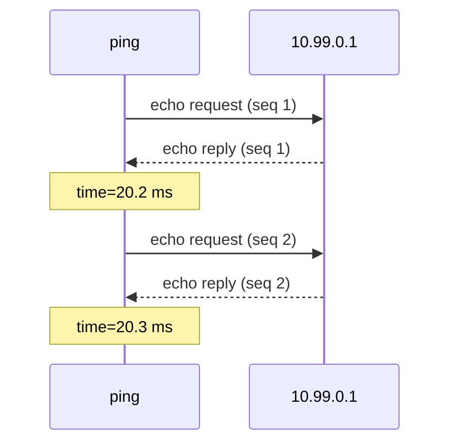
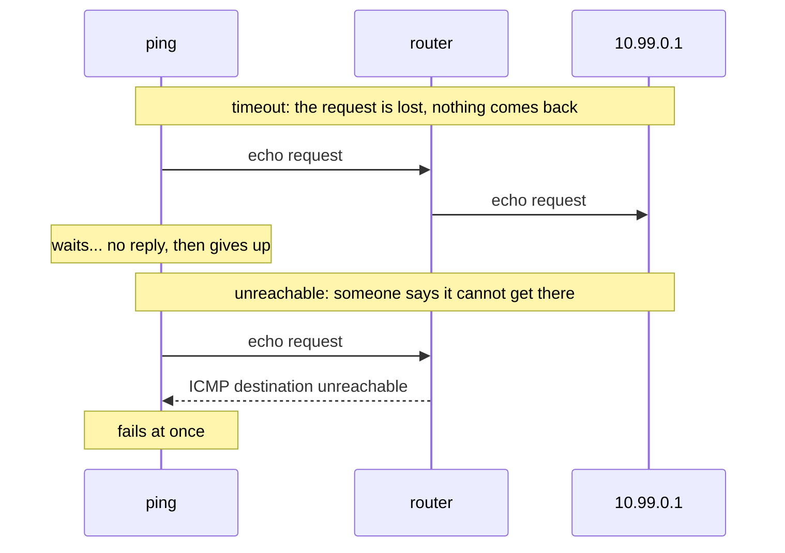
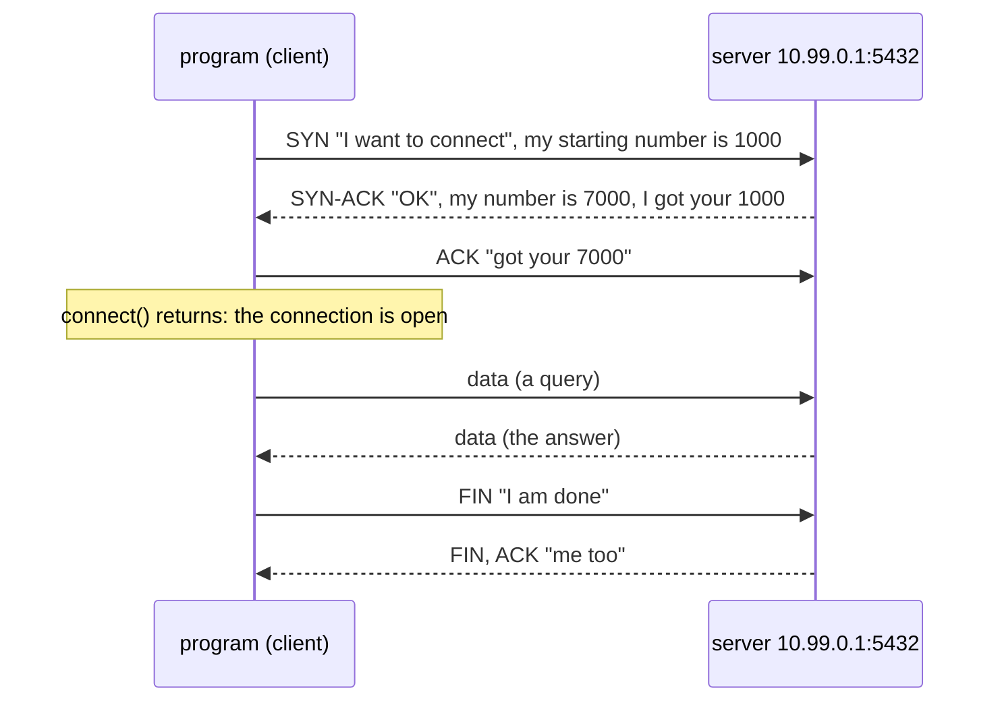
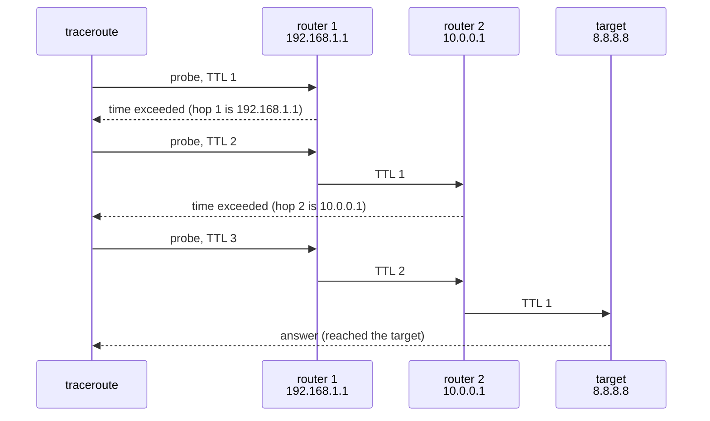
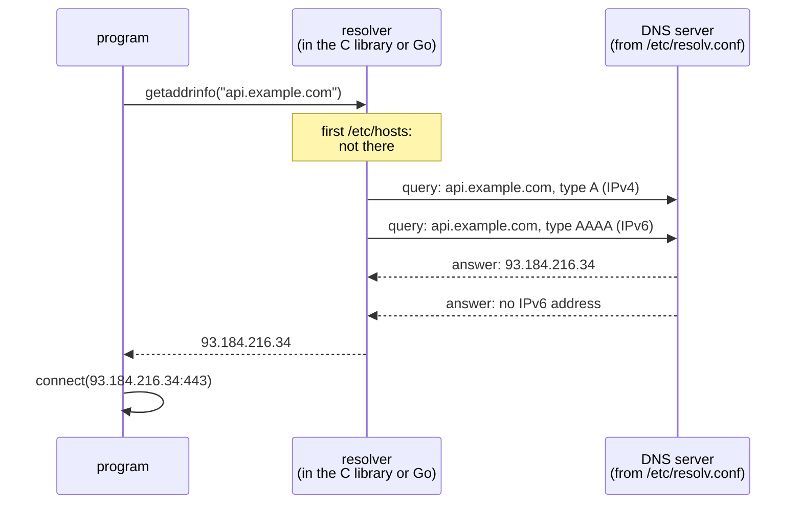
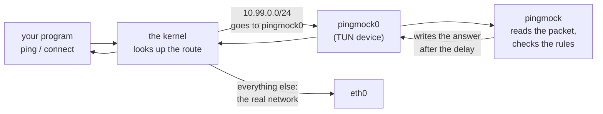

# Network basics for pingmock

English | [中文](basics.zh-CN.md)

This page explains the networking that pingmock relies on, for readers who write programs but have never looked inside a network packet. It covers what an address and a port are, what ping, a TCP connection and a DNS lookup actually send, and how pingmock gets in the middle to fake the answers. Each part ends with what it means for pingmock. Read it in order the first time; afterwards, [the glossary](#glossary) at the end is enough.

Once this page makes sense, [the README](../README.md) shows how to use pingmock, [Inside the packets](packets.md) takes real packets apart byte by byte, and [the code tour](architecture.md) shows how pingmock is built.

## 1. Addresses, subnets and ports

Every machine on a network has an **IP address**, such as `10.99.0.1` (IPv4, four numbers from 0 to 255) or `fd99::1` (IPv6, longer, written in hexadecimal). Data travels in **packets**, and every packet carries the address it comes from and the address it goes to.

A **subnet** is a range of addresses, written as a first address and a number of fixed bits: `10.99.0.0/24` means the first 24 bits (the first three numbers) are fixed, so it covers `10.99.0.0` to `10.99.0.255`. pingmock uses this range by default for its pretend hosts; nothing real uses it.

One machine runs many programs, so an address is not enough to say which program a packet is for. A **port**, a number from 1 to 65535, picks the program: a web server listens on port 443 (HTTPS) or 80 (HTTP), PostgreSQL on 5432. `10.99.0.1:5432` means "port 5432 at 10.99.0.1".

```
             10.99.0.1                 the machine
   ┌──────────────────────────┐
   │  port 80    web server   │
   │  port 5432  database     │        the program on it
   │  port 22    SSH          │
   └──────────────────────────┘
```

Ping has no ports: it talks to the machine itself.

**For pingmock**: rules are written for addresses (`-rule 10.99.0.1=50ms`), for subnets (`-rule 10.99.0.0/24=timeout`), and for TCP also for ports (`-tcp 10.99.0.1:5432=refuse`).

## 2. Packets are layered

A packet is a series of bytes, made of nested parts. Each layer has a **header**, a few bytes in a fixed layout, followed by what it carries:

```
┌─────────────────┬──────────────────────┬────────────────────────┐
│    IP header    │   ICMP, TCP or UDP   │          data          │
│    20 bytes     │        header        │  (the actual content)  │
│ from, to, what  │   type or ports...   │                        │
│  it carries...  │                      │                        │
└─────────────────┴──────────────────────┴────────────────────────┘
```

- The **IP header** says where the packet comes from and goes to, and what it carries: protocol 1 is ICMP (ping), 6 is TCP, 17 is UDP (DNS uses UDP).
- The next header belongs to that protocol: ICMP says what kind of message it is, TCP and UDP give the ports.
- The data is whatever the program sends: a web page, a database query.

The IPv4 header, as RFCs draw it, 32 bits (4 bytes) per row:

```
 0                   1                   2                   3
 0 1 2 3 4 5 6 7 8 9 0 1 2 3 4 5 6 7 8 9 0 1 2 3 4 5 6 7 8 9 0 1
+-------+-------+---------------+-------------------------------+
|Version|  IHL  |      TOS      |          Total length         |
+-------+-------+---------------+-----+-------------------------+
|        Identification         |Flags|     Fragment offset     |
+---------------+---------------+-----+-------------------------+
|      TTL      |   Protocol    |        Header checksum        |
+---------------+---------------+-------------------------------+
|                        Source address                         |
+---------------------------------------------------------------+
|                      Destination address                      |
+---------------------------------------------------------------+
```

The fields that matter here: **Protocol** (what follows), **Source** and **Destination address**, and **TTL**, a counter every router lowers by one, which traceroute uses (section 6).

**For pingmock**: it reads every packet sent to the addresses it mocks, looks at these headers to recognize pings and connection attempts, and writes back answers built byte by byte. [Inside the packets](packets.md) does this with real packets.

## 3. Ping: ICMP echo

`ping 10.99.0.1` sends an **echo request**, a small ICMP message, and the machine at that address answers with an **echo reply**. ping measures the time between the two: the **round-trip time**, or latency.



The ICMP echo message, after the IP header:

```
 0                   1                   2                   3
 0 1 2 3 4 5 6 7 8 9 0 1 2 3 4 5 6 7 8 9 0 1 2 3 4 5 6 7 8 9 0 1
+---------------+---------------+-------------------------------+
|     Type      |     Code      |           Checksum            |
|  8 = request  |       0       |                               |
|   0 = reply   |               |                               |
+---------------+---------------+-------------------------------+
|          Identifier           |        Sequence number        |
+-------------------------------+-------------------------------+
|  Data: ping puts the time it sent the request here, and the   |
|                     reply carries it back                     |
+---------------------------------------------------------------+
```

Three words describe how well a network answers:

- **Latency**: how long the round trip takes. 20 ms is a nearby server, 300 ms is the other side of the world or a bad link.
- **Jitter**: how much the latency varies from one ping to the next.
- **Packet loss**: the share of requests that never get an answer. ping shows it as `10% packet loss`.

**For pingmock**: a rule such as `delay=50ms,jitter=10ms,loss=5%` sets these three for a target. pingmock answers each request itself, after the delay, or drops it; the payload goes back unchanged, so ping's own measurement shows the delay you asked for.

## 4. When there is no answer: timeout versus unreachable

A request can fail in two very different ways, and programs often treat them differently:



- **Timeout**: nothing comes back. The program waits until it gives up, often seconds. This is what a dead machine or a firewall that silently drops looks like.
- **Unreachable**: a router, or the target itself, answers with an ICMP error ("destination unreachable", ICMP type 3). The program knows at once, without waiting. There are several reasons: host unreachable, network unreachable, administratively prohibited (a firewall that rejects).

**For pingmock**: `timeout` or `loss=` give the first, `unreachable[=host|net|admin]` the second. The README's [Unreachable versus timeout](../README.md#unreachable-versus-timeout) has the details.

## 5. TCP connections

Most programs do not ping; they **connect**: to a database, a web server, an API. TCP is the protocol for that, and a connection starts with a **three-way handshake**:



SYN, ACK, FIN and RST are **flags**, single bits in the TCP header that say what a segment is. The TCP header:

```
 0                   1                   2                   3
 0 1 2 3 4 5 6 7 8 9 0 1 2 3 4 5 6 7 8 9 0 1 2 3 4 5 6 7 8 9 0 1
+-------------------------------+-------------------------------+
|          Source port          |       Destination port        |
+-------------------------------+-------------------------------+
|                        Sequence number                        |
|        (counts the bytes sent; random start, the "ISN")       |
+---------------------------------------------------------------+
|                     Acknowledgment number                     |
|           (the next byte expected from the other side)        |
+-------+-------+---------------+-------------------------------+
| Data  |       |C E U A P R S F|                               |
|offset |       |W C R C S S Y I|            Window             |
|       |       |R E G K H T N N|    (how much it can receive)  |
|       |       |     Flags     |                               |
+-------+-------+---------------+-------------------------------+
|           Checksum            |        Urgent pointer         |
+-------------------------------+-------------------------------+
|              Options (MSS, timestamps...), then data          |
+---------------------------------------------------------------+
```

A connection can fail in more ways than a ping:

| What happens | What the program sees |
|---|---|
| The SYN gets no answer | `connect` times out after a while: "connection timed out" |
| The server answers SYN with **RST** (reset), as when no program listens on the port | `connect` fails at once: "connection refused" (`ECONNREFUSED`) |
| An ICMP unreachable error comes back | `connect` fails at once: "no route to host" |
| The connection opens, but the server never sends anything | reading times out: the connection is open but silent |
| The connection opens, then the server closes it (**FIN**) | reading gets end of file; an HTTP client reports an empty reply |
| The connection opens, then the server resets it (**RST**) | "connection reset by peer" (`ECONNRESET`) |

**For pingmock**: a TCP rule picks one of these per address and port: `5ms` accepts after 5 ms, `refuse` answers RST, `timeout` never answers, `unreachable` sends the ICMP error, and `after=hang|close|reset` decides what happens once the connection is open. pingmock does not run a server: it writes the SYN-ACK, RST or FIN itself, and the program's own kernel does the rest of the handshake. See [TCP connections](../README.md#tcp-connections).

## 6. traceroute: TTL and hops

Between you and a server there are **routers**, each passing the packet one step on: each step is a **hop**. Every router lowers the packet's **TTL** by one, and when it reaches 0, the router drops the packet and answers with an ICMP **time exceeded** error, from its own address. traceroute uses this on purpose: it sends a packet with TTL 1, then 2, then 3, and each router in turn reveals itself.



**For pingmock**: a path (`-path '8.8.8.8=192.168.1.1@2ms > 10.0.0.1@15ms'`) makes up these routers: pingmock answers each probe as the router where its TTL ran out would. See [Paths](../README.md#paths-traceroute-and-mtr).

## 7. DNS: from a name to an address

Programs rarely use addresses directly; they use names such as `api.example.com`. Before connecting, the program **resolves** the name: it asks a **DNS server** which address the name has.



- The **resolver** is the part of the C library (or of Go) that does this for the program. It reads `/etc/hosts` first, a file of fixed names and addresses, then asks the DNS server named in `/etc/resolv.conf`.
- It usually asks for an IPv4 address (**type A**) and an IPv6 address (**type AAAA**) at once.
- Queries usually travel over UDP, port 53. A DNS message has a 12-byte header (an ID, flags, an answer code and counts), then the question, then the answers:

```
+--------------------------------------+
| Header (12 bytes)                    |
|   ID, flags, RCODE (the answer code),|
|   number of questions and answers    |
+--------------------------------------+
| Question: the name and the type      |
|   api.example.com, type A            |
+--------------------------------------+
| Answers: name, type, TTL, address    |
|   api.example.com A 93.184.216.34    |
+--------------------------------------+
```

The answer code says how it went:

| Answer | What the program sees |
|---|---|
| An address | the name resolves |
| **NXDOMAIN**: the name does not exist | fails at once: "Name or service not known" |
| **SERVFAIL**: the server failed | the resolver tries again, then: "Temporary failure in name resolution" |
| No answer | the resolver waits (5 seconds by default), tries again, then fails as for SERVFAIL |

**For pingmock**: under `pingmock exec`, the command gets its own `/etc/hosts` and `/etc/resolv.conf`, pointing at a small DNS server pingmock runs for it. That is how a rule can be written for a name (`-rule api.example.com=80ms`), and how a DNS rule makes a name fail (`-dns api.example.com=nxdomain`). See [Names](../README.md#names) and [DNS faults](../README.md#dns-faults).

## 8. How pingmock gets in the middle

The kernel decides where each packet goes with the **routing table**: "addresses in this range leave through that network interface". pingmock creates a **virtual network interface**, a TUN device called `pingmock0`, and adds routes so that the addresses it mocks go there. A TUN device has no cable behind it: every packet the kernel sends to it is read by a program, and every packet that program writes comes back to the kernel as if it had arrived from the network.



So the program needs no change: it pings or connects as usual, the kernel hands the packet to pingmock, and pingmock writes back the answer you decided. [The round trip of one ping](packet-path.md) follows a packet through the kernel step by step.

There are two ways to run it:

- **`sudo pingmock`** changes the routes of the whole machine, so it needs root (administrator) rights, and every program on the machine sees the mocked addresses.
- **`pingmock exec -- ./my-app`** needs no root: it gives the command a private copy of the network, a **network namespace**, with its own interfaces and routes. Only that command sees the mocked network, and nothing on the machine changes.

## Glossary

| Word | Meaning |
|---|---|
| **IP address** | the address of a machine: `10.99.0.1` (IPv4) or `fd99::1` (IPv6) |
| **subnet**, **prefix**, **CIDR** | a range of addresses: `10.99.0.0/24` is `10.99.0.0` to `10.99.0.255` |
| **port** | which program on a machine: 443 for HTTPS, 5432 for PostgreSQL |
| **packet** | one unit of data on the network: headers, then data |
| **header** | the fixed-layout bytes at the start of a packet or layer |
| **ICMP** | the protocol of ping and of network error messages |
| **echo request / reply** | the ping question and its answer |
| **latency**, **round-trip time** | how long a request takes to come back |
| **jitter** | how much the latency varies |
| **packet loss** | the share of requests with no answer |
| **timeout** | giving up after waiting for an answer that never came |
| **unreachable** | an ICMP error saying the destination cannot be reached |
| **TCP** | the protocol of connections: web, databases, most APIs |
| **handshake**, **SYN**, **SYN-ACK**, **ACK** | the three segments that open a TCP connection |
| **RST**, **reset** | aborts a connection; in answer to a SYN, "connection refused" |
| **FIN** | closes a connection normally |
| **UDP** | a protocol without connections, used by DNS |
| **TTL**, **hop** | the counter routers lower by one; each router on the way |
| **traceroute**, **mtr** | tools that list the routers on the way to a target |
| **DNS**, **resolve** | turning a name into an address |
| **resolver** | the part of a program's library that resolves names |
| **A**, **AAAA** | the DNS types for an IPv4 and an IPv6 address |
| **NXDOMAIN**, **SERVFAIL** | DNS answers: the name does not exist; the server failed |
| **`/etc/hosts`**, **`/etc/resolv.conf`** | fixed names, and which DNS server to ask |
| **routing table** | the kernel's list of where each range of addresses goes |
| **network interface** | where packets leave the machine: `eth0`, `wlan0`, `pingmock0` |
| **TUN device** | a virtual interface whose packets a program reads and writes |
| **network namespace** | a private copy of the network for some processes |
| **root** | the administrator account on Linux |
| **mock** | a stand-in that gives the answers a test decides on |
| **seed** | a number that makes random choices repeat the same way |
