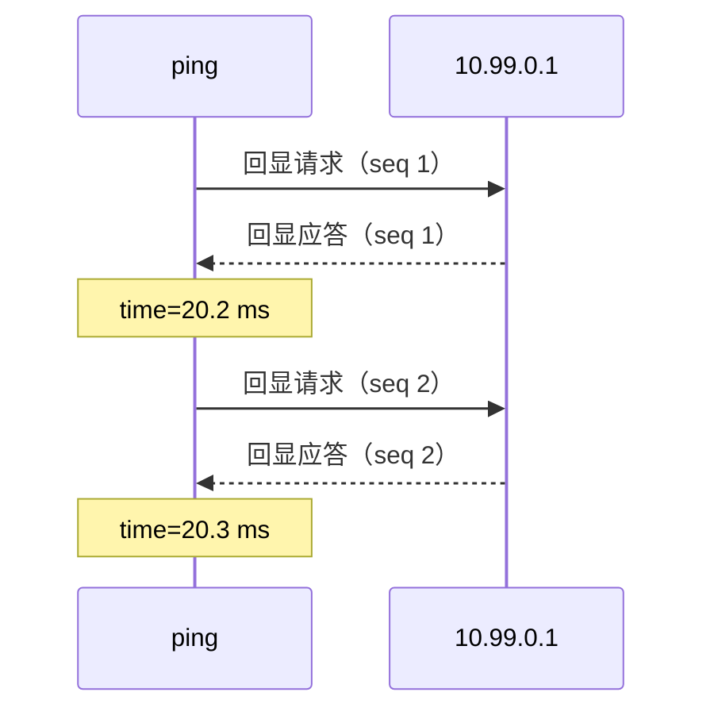
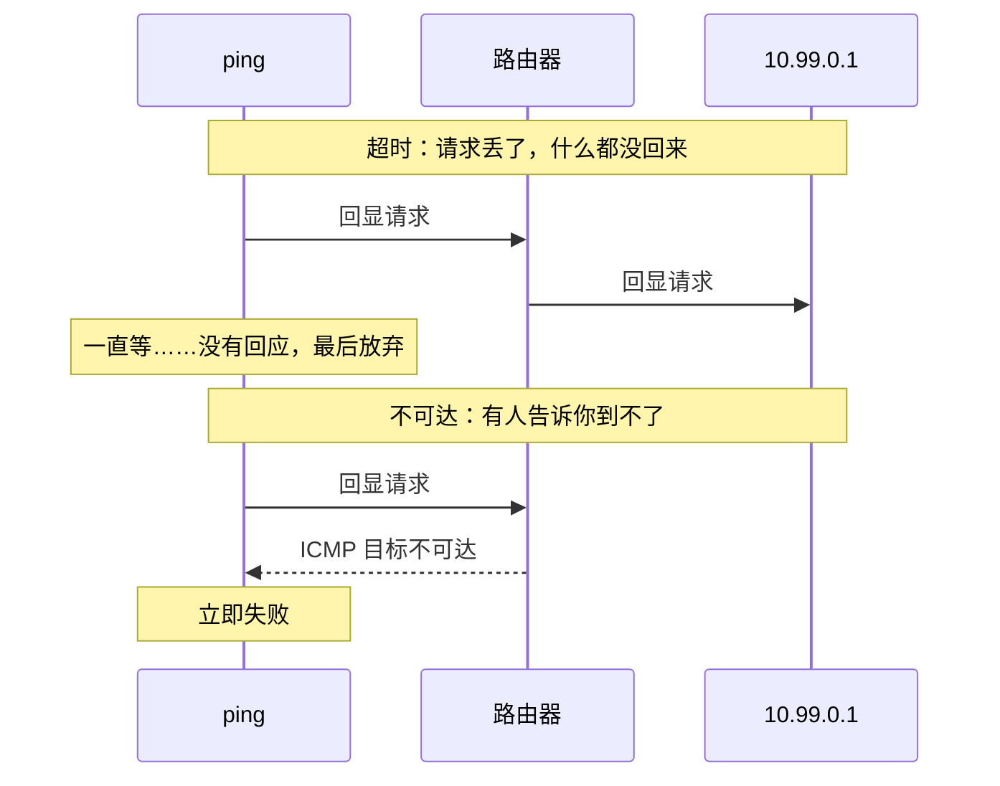
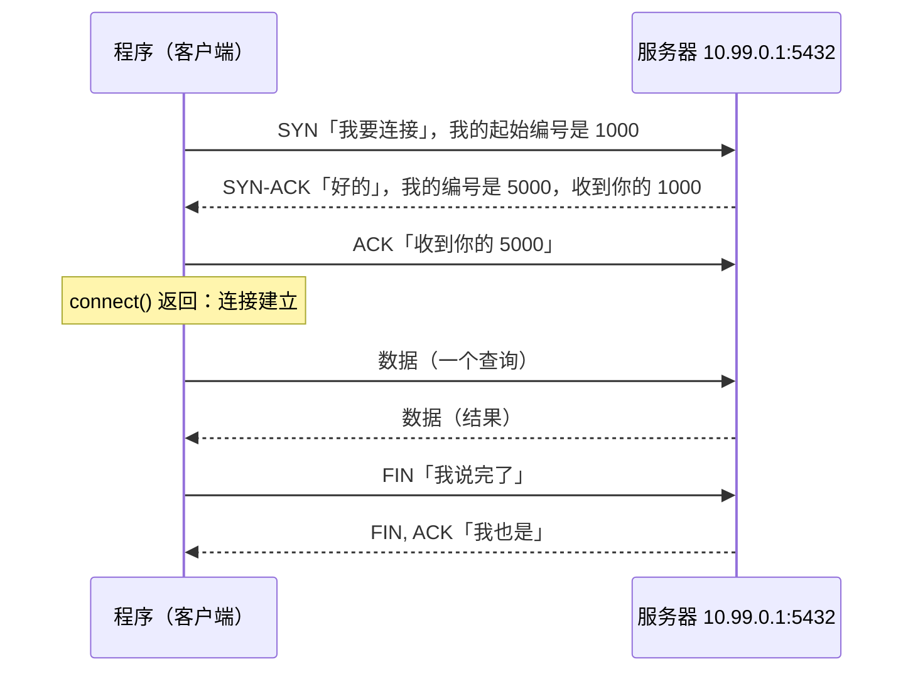
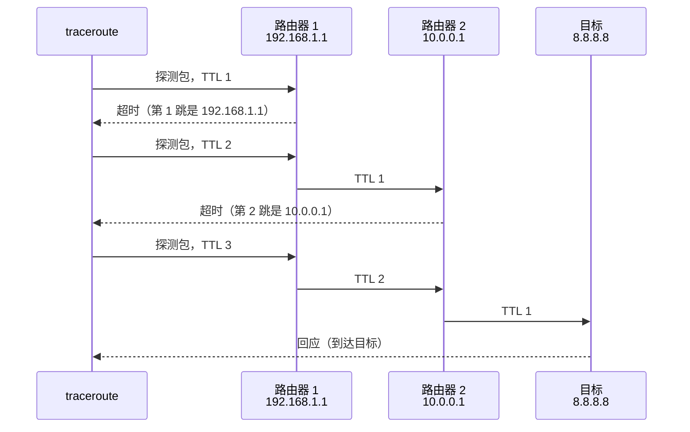
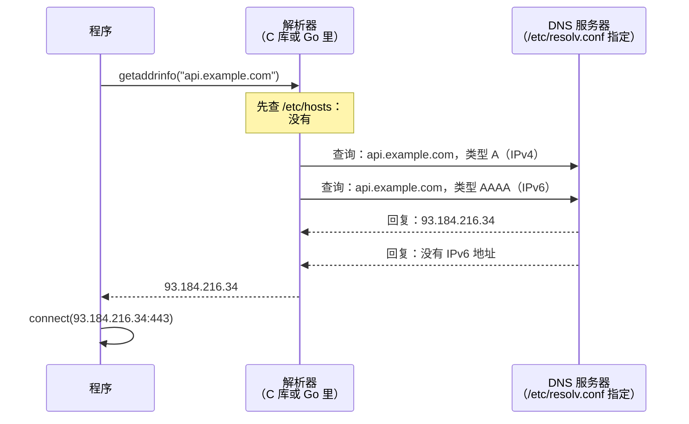
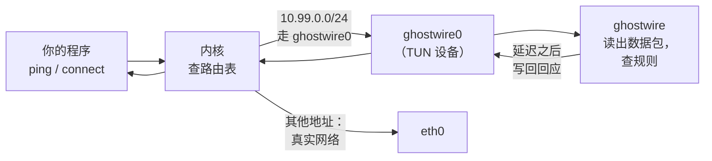
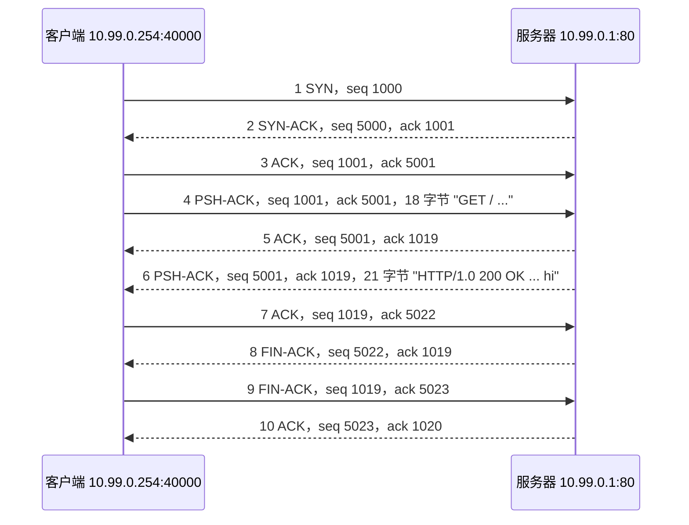

# ghostwire 用到的网络基础

[English](basics.md) | 中文

这一页写给会写程序、但从没看过网络数据包内部的读者，讲清楚 ghostwire 依赖的网络知识：地址和端口是什么，ping、TCP 连接、DNS 解析实际发了什么，以及 ghostwire 怎样插到中间、伪造回应。每一部分最后都说明它和 ghostwire 的关系。第一次请按顺序读；以后查最后的[术语表](#术语表)就够了。第 9 节再逐字节读一次 TCP 对话、一次 ping 和一次 DNS 解析。

读懂这一页之后，[README](../README.zh-CN.md) 讲怎么用 ghostwire，[数据包详解](packets.zh-CN.md)逐字节拆解真实的数据包，[代码导读](architecture.zh-CN.md)讲 ghostwire 是怎样实现的。

## 1. 地址、网段和端口

网络上的每台机器都有一个 **IP 地址**，比如 `10.99.0.1`（IPv4，四个 0 到 255 的数）或 `fd99::1`（IPv6，更长，用十六进制写）。数据以**数据包**为单位传输，每个数据包都带着它从哪个地址来、到哪个地址去。

**网段**是一段地址，写成起始地址加固定的位数：`10.99.0.0/24` 表示前 24 位（前三个数）固定，也就是 `10.99.0.0` 到 `10.99.0.255`。ghostwire 默认用这一段当作假装的主机，没有真实的东西用它。

一台机器上跑着很多程序，光有地址还不知道数据包是给哪个程序的。**端口**是 1 到 65535 的一个数，用来选程序：网页服务器监听 443（HTTPS）或 80（HTTP），PostgreSQL 监听 5432。`10.99.0.1:5432` 就是「10.99.0.1 上的 5432 端口」。

```
10.99.0.1              一台机器
  ├─ :80               网页服务器
  ├─ :5432             数据库
  └─ :22               SSH
```

ping 没有端口：它找的是机器本身。

**和 ghostwire 的关系**：规则可以写给地址（`-rule 10.99.0.1=50ms`）、网段（`-rule 10.99.0.0/24=timeout`），TCP 规则还可以写给端口（`-tcp 10.99.0.1:5432=refuse`）。

## 2. 数据包是分层的

一个数据包是一串字节，由一层套一层的部分组成。每一层有一个**头部**，按固定格式排列的几个字节，后面跟着它装的东西：

| IP 头部（20 字节） | ICMP、TCP 或 UDP 头部 | 数据 |
|---|---|---|
| 从哪来、到哪去、装的是什么 | 消息类型，或者端口 | 真正的内容：网页、查询…… |

- **IP 头部**说明数据包从哪来、到哪去、装的是什么：协议号 1 是 ICMP（ping），6 是 TCP，17 是 UDP（DNS 用 UDP）。
- 接下来是这个协议的头部：ICMP 说明是哪种消息，TCP 和 UDP 给出端口。
- 数据是程序发送的内容：网页、数据库查询。

IPv4 头部，按 RFC 的画法，每行 32 位（4 字节）：

```
 0                   1                   2                   3
 0 1 2 3 4 5 6 7 8 9 0 1 2 3 4 5 6 7 8 9 0 1 2 3 4 5 6 7 8 9 0 1
+-------+-------+---------------+-------------------------------+
|Version|  IHL  |      TOS      |          Total length         |
+-------+-------+---------------+-----+-------------------------+
|        Identification         |Flags|     Fragment offset     |
+---------------+---------------+-----+-------------------------+
|      TTL      |   Protocol    |        Header checksum        |
+---------------+---------------+-------------------------------+
|                        Source address                         |
+---------------------------------------------------------------+
|                      Destination address                      |
+---------------------------------------------------------------+
```

图里的字段名和 RFC 一样用英文，对应的中文：

| 字段 | 中文 | 字段 | 中文 |
|---|---|---|---|
| Version | 版本 | IHL | 头部长度（以 4 字节为单位） |
| TOS | 服务类型 | Total length | 总长度 |
| Identification | 标识 | Flags | 标志 |
| Fragment offset | 分片偏移 | TTL | 生存时间（跳数） |
| Protocol | 协议号 | Header checksum | 头部校验和 |
| Source address | 源地址 | Destination address | 目的地址 |

这里要关心的字段：**协议号**（后面跟着什么）、**源地址**和**目的地址**，以及 **TTL**：每经过一台路由器减一的计数器，traceroute 靠它工作（第 6 节）。

**和 ghostwire 的关系**：ghostwire 读取发往它模拟的地址的每个数据包，看这些头部来识别 ping 和连接请求，再逐字节构造回应写回去。[数据包详解](packets.zh-CN.md)用真实的数据包演示了这个过程。

## 3. ping：ICMP 回显

`ping 10.99.0.1` 发出一个**回显请求**（echo request，一条很小的 ICMP 消息），那个地址上的机器回一个**回显应答**（echo reply）。ping 测量两者之间的时间：**往返时间**，也就是延迟。



IP 头部之后的 ICMP 回显消息：

```
 0                   1                   2                   3
 0 1 2 3 4 5 6 7 8 9 0 1 2 3 4 5 6 7 8 9 0 1 2 3 4 5 6 7 8 9 0 1
+---------------+---------------+-------------------------------+
|     Type      |     Code      |           Checksum            |
|  8 = request  |       0       |                               |
|   0 = reply   |               |                               |
+---------------+---------------+-------------------------------+
|          Identifier           |        Sequence number        |
+-------------------------------+-------------------------------+
|  Data: ping puts the time it sent the request here, and the   |
|                     reply carries it back                     |
+---------------------------------------------------------------+
```

Type 是类型（8 为请求，0 为应答），Code 是代码，Checksum 是校验和，Identifier 是标识符，Sequence number 是序号，Data 是数据：ping 把发出请求的时间写在数据里，应答原样带回。

描述网络回应好坏的三个词：

- **延迟**：往返一次要多久。20ms 是附近的服务器，300ms 是地球另一边或者很差的线路。
- **抖动**：延迟每次之间变化多大。
- **丢包**：有多大比例的请求得不到回应。ping 显示为 `10% packet loss`。

**和 ghostwire 的关系**：`delay=50ms,jitter=10ms,loss=5%` 这样的规则为一个目标设定这三项。ghostwire 自己回应每个请求，在延迟之后回复，或者丢掉它；数据原样带回，所以 ping 自己测出来的就是你设定的延迟。

## 4. 没有回应时：超时和不可达

一个请求可以有两种完全不同的失败方式，程序往往会区别对待：



- **超时**：什么都没回来。程序一直等到放弃，往往要几秒。机器宕机、防火墙悄悄丢弃，看起来就是这样。
- **不可达**：路由器或目标本身回一个 ICMP 错误（「目标不可达」，ICMP 类型 3）。程序立刻就知道，不用等。原因有几种：主机不可达、网络不可达、被管理员禁止（防火墙拒绝）。

**和 ghostwire 的关系**：`timeout` 或 `loss=` 是前一种，`unreachable[=host|net|admin]` 是后一种。详见 README 的[不可达与超时](../README.zh-CN.md#不可达与超时)。

## 5. TCP 连接

大多数程序不 ping，而是**建立连接**：连数据库、网页服务器、API。TCP 就是做这个的协议，一个连接从**三次握手**开始：



SYN、ACK、FIN、RST 是**标志位**：TCP 头部里的单个比特，说明这个报文是什么。TCP 头部：

```
 0                   1                   2                   3
 0 1 2 3 4 5 6 7 8 9 0 1 2 3 4 5 6 7 8 9 0 1 2 3 4 5 6 7 8 9 0 1
+-------------------------------+-------------------------------+
|          Source port          |       Destination port        |
+-------------------------------+-------------------------------+
|                        Sequence number                        |
|        (counts the bytes sent; random start, the "ISN")       |
+---------------------------------------------------------------+
|                     Acknowledgment number                     |
|           (the next byte expected from the other side)        |
+-------+-------+---------------+-------------------------------+
| Data  |       |C E U A P R S F|                               |
|offset |       |W C R C S S Y I|            Window             |
|       |       |R E G K H T N N|    (how much it can receive)  |
|       |       |     Flags     |                               |
+-------+-------+---------------+-------------------------------+
|           Checksum            |        Urgent pointer         |
+-------------------------------+-------------------------------+
|              Options (MSS, timestamps...), then data          |
+---------------------------------------------------------------+
```

| 字段 | 中文 | 说明 |
|---|---|---|
| Source port、Destination port | 源端口、目的端口 | |
| Sequence number | 序号 | 给发出的字节编号；起点随机，称为 ISN |
| Acknowledgment number | 确认号 | 期待对方发来的下一个字节 |
| Data offset | 数据偏移 | 头部长度，以 4 字节为单位 |
| Flags | 标志位 | CWR、ECE、URG、ACK、PSH、RST、SYN、FIN 各占一位 |
| Window | 窗口 | 还能接收多少数据 |
| Checksum | 校验和 | |
| Urgent pointer | 紧急指针 | |
| Options | 选项 | MSS、时间戳等，之后是数据 |

连接失败的方式比 ping 多：

| 发生了什么 | 程序看到的 |
|---|---|
| SYN 没有回应 | `connect` 等一阵后超时：「connection timed out」 |
| 服务器用 **RST**（重置）回应 SYN，端口上没有程序监听时就是这样 | `connect` 立即失败：「connection refused」（`ECONNREFUSED`） |
| 回来一个 ICMP 不可达错误 | `connect` 立即失败：「no route to host」 |
| 连接建立了，服务器却什么都不发 | 读取超时：连接开着，但没有声音 |
| 连接建立后，服务器关闭了它（**FIN**） | 读到文件结束；HTTP 客户端报空回复 |
| 连接建立后，服务器重置了它（**RST**） | 「connection reset by peer」（`ECONNRESET`） |

**和 ghostwire 的关系**：TCP 规则为每个地址和端口选其中一种：`5ms` 在 5ms 后接受，`refuse` 回 RST，`timeout` 不回应，`unreachable` 回 ICMP 错误，`after=hang|close|reset` 决定连接建立之后怎样，`send=` 和 `reply=` 在连接上发送固定的字节。ghostwire 并不运行服务器：它自己写出 SYN-ACK、RST、FIN 或数据报文，握手的其余部分由程序自己的内核完成。没有 TCP 规则的端口不会得到回应，除非这个地址设了[路径](../README.zh-CN.md#路径traceroute-和-mtr)，路径的目标接受任何端口的连接。见 [TCP 连接](../README.zh-CN.md#tcp-连接)。

## 6. traceroute：TTL 和跳

你和服务器之间有**路由器**，每台把数据包往前传一步，每一步叫一**跳**。每台路由器把数据包的 **TTL** 减一，减到 0 时就丢掉它，并从自己的地址回一个 ICMP **超时**错误（time exceeded）。traceroute 故意利用这一点：先发 TTL 为 1 的包，再发 2、3……每台路由器依次暴露出来。



**和 ghostwire 的关系**：路径（`-path '8.8.8.8=192.168.1.1@2ms > 10.0.0.1@15ms'`）凭空造出这些路由器：ghostwire 替 TTL 耗尽处的那台路由器回应每个探测包。见[路径](../README.zh-CN.md#路径traceroute-和-mtr)。

## 7. DNS：从域名到地址

程序很少直接用地址，而是用 `api.example.com` 这样的域名。连接之前，程序要**解析**域名：问 **DNS 服务器**这个域名对应哪个地址。



- **解析器**是 C 库（或 Go）里替程序做这件事的部分。它先读 `/etc/hosts`，一个写死了域名和地址的文件，再去问 `/etc/resolv.conf` 里指定的 DNS 服务器。
- 它通常同时查 IPv4 地址（**A 类型**）和 IPv6 地址（**AAAA 类型**）。
- 查询通常走 UDP 的 53 端口。DNS 消息是 12 字节的头部（ID、标志、回复码和几个计数），然后是问题，然后是回答：

| 部分 | 内容 | 例子 |
|---|---|---|
| 头部（12 字节） | ID、标志、RCODE（回复码）、问题和回答的个数 | |
| 问题 | 域名和类型 | api.example.com，类型 A |
| 回答 | 域名、类型、TTL、地址 | api.example.com A 93.184.216.34 |

回复码说明结果如何：

| 回复 | 程序看到的 |
|---|---|
| 一个地址 | 解析成功 |
| **NXDOMAIN**：域名不存在 | 立即失败：「Name or service not known」 |
| **SERVFAIL**：服务器出错 | 解析器重试，然后：「Temporary failure in name resolution」 |
| 没有回复 | 解析器等待（默认 5 秒）、重试，然后和 SERVFAIL 一样失败 |

**和 ghostwire 的关系**：在 `ghostwire exec` 下，命令拿到自己的 `/etc/hosts` 和 `/etc/resolv.conf`，指向 ghostwire 为它运行的一个小 DNS 服务。所以规则可以写给域名（`-rule api.example.com=80ms`），DNS 规则也能让一个域名解析失败（`-dns api.example.com=nxdomain`）。见[域名](../README.zh-CN.md#域名)和 [DNS 故障](../README.zh-CN.md#dns-故障)。

## 8. ghostwire 怎样插到中间

内核用**路由表**决定每个数据包往哪走：「这一段地址从那块网卡出去」。ghostwire 创建一块**虚拟网卡**，一个名叫 `ghostwire0` 的 TUN 设备，并加上路由，让它模拟的地址都走这块网卡。TUN 设备后面没有网线：内核发给它的每个数据包都由一个程序读走，这个程序写入的每个数据包又回到内核，就像从网络上收到的一样。



所以程序不需要任何改动：它照常 ping、照常连接，内核把数据包交给 ghostwire，ghostwire 写回你设定的回应。[一个 ping 的往返之旅](packet-path.zh-CN.md)一步步跟着一个数据包走过内核。

有两种运行方式：

- **`sudo ghostwire`** 修改整台机器的路由，所以需要 root（管理员）权限，机器上所有程序都会看到模拟的地址。
- **`ghostwire exec -- ./my-app`** 不需要 root：它给命令一份私有的网络，即**网络命名空间**，有自己的网卡和路由。只有这个命令看到模拟的网络，机器上什么都不会改变。

## 9. 逐字节的完整例子

这一节手工拼出几个数据包，逐字节读一遍：一次完整的 TCP 对话、一次 ping、一次 DNS 解析。数字特意挑得好算（客户端从 1000 开始计数，服务器从 5000 开始），TCP 头部也不带选项；真实的数据包会更复杂，[数据包详解](packets.zh-CN.md)拆解的就是真实抓到的包。这些包仍然是合法的：校验和都正确，`tcpdump -vv` 能逐个解析，没有任何报错。

地址用 ghostwire 的默认值：程序在 **10.99.0.254** 的 40000 端口，访问 **10.99.0.1** 上 80 端口的网页服务器。

### 9.1 怎样读十六进制

数据包用**十六进制**显示：每个字节是两位 `0` 到 `f` 的数字，`00` 到 `ff` 就是 0 到 255。一个字节 8 位，每位十六进制数字对应其中 4 位：

下面每行依次是十六进制、二进制、十进制：

```
0x18  =  0001 1000  =  1×16 + 8    =  24
0xff  =  1111 1111  =  15×16 + 15  =  255
```

超过一个字节的数，**高位字节在前**（叫「网络字节序」）：

```
03 e8        = 0x03 × 256 + 0xe8      = 3 × 256 + 232 = 1000
00 00 13 88  = 0x1388                 = 1 × 4096 + 3 × 256 + 8 × 16 + 8 = 5000
9c 40        = 0x9c × 256 + 0x40      = 156 × 256 + 64 = 40000
0a 63 00 fe  = 10.99.0.254            IPv4 地址是 4 个字节，每个数一个字节
```

`0010  0a 63 00 01 ...` 这样的转储，开头是十六进制的**偏移量**：`0010` 表示这一行从第 16 个字节开始。

### 9.2 整个对话

一个程序取一个网页：建立连接，发出 `GET / HTTP/1.0`，收到 `HTTP/1.0 200 OK` 和文本 `hi`，然后双方关闭连接。一共十个包：



| # | 谁发的 | 标志位 | 序号 | 确认号 | 数据 | 意思 |
|---|---|---|---|---|---|---|
| 1 | 客户端 | SYN | 1000 | | | 「我要连接，我从 1000 开始计数」 |
| 2 | 服务器 | SYN、ACK | 5000 | 1001 | | 「好的，我从 5000 开始；收到你的 SYN，下一个请发 1001」 |
| 3 | 客户端 | ACK | 1001 | 5001 | | 「收到你的 SYN」：连接建立 |
| 4 | 客户端 | PSH、ACK | 1001 | 5001 | 18 字节 | 请求，第 1001 到 1018 字节 |
| 5 | 服务器 | ACK | 5001 | 1019 | | 「1018 之前的都收到了」 |
| 6 | 服务器 | PSH、ACK | 5001 | 1019 | 21 字节 | 回复，第 5001 到 5021 字节 |
| 7 | 客户端 | ACK | 1019 | 5022 | | 「5021 之前的都收到了」 |
| 8 | 服务器 | FIN、ACK | 5022 | 1019 | | 「我发完了」 |
| 9 | 客户端 | FIN、ACK | 1019 | 5023 | | 「收到你的 FIN，我也发完了」 |
| 10 | 服务器 | ACK | 5023 | 1020 | | 「收到你的 FIN」：连接关闭 |

### 9.3 SYN 的每一个字节

第 1 个包 40 字节：20 字节 IP 头部，20 字节 TCP 头部，没有数据。

```
0000  45 00 00 28 10 01 40 00 40 06 15 0b 0a 63 00 fe
0010  0a 63 00 01 9c 40 00 50 00 00 03 e8 00 00 00 00
0020  50 02 ff ff f9 a5 00 00
```

IP 头部，第 0 到 19 字节：

| 字节 | 十六进制 | 字段 | 值 |
|---|---|---|---|
| 0 | `45` | 版本、头部长度 | 高 4 位是 4：IPv4；低 4 位是 5：5 × 4 = 20 字节头部 |
| 1 | `00` | 服务类型 | 0，没有特殊要求 |
| 2-3 | `00 28` | 总长度 | 40 字节，头部加上它装的所有东西 |
| 4-5 | `10 01` | 标识 | 发送方给每个包编的号，分片时用 |
| 6-7 | `40 00` | 标志、分片偏移 | `0x4000`：设置了「不分片」，偏移 0 |
| 8 | `40` | TTL | 64：最多还能被路由器转发 64 次 |
| 9 | `06` | 协议号 | 6：后面是 TCP |
| 10-11 | `15 0b` | 头部校验和 | 让接收方发现头部是否损坏 |
| 12-15 | `0a 63 00 fe` | 源地址 | 10.99.0.254，客户端 |
| 16-19 | `0a 63 00 01` | 目的地址 | 10.99.0.1，服务器 |

TCP 头部，第 20 到 39 字节：

| 字节 | 十六进制 | 字段 | 值 |
|---|---|---|---|
| 20-21 | `9c 40` | 源端口 | 40000，客户端内核选的 |
| 22-23 | `00 50` | 目的端口 | 80，网页服务器 |
| 24-27 | `00 00 03 e8` | 序号 | 1000，客户端的起始编号（ISN） |
| 28-31 | `00 00 00 00` | 确认号 | 0：还没有要确认的 |
| 32 | `50` | 数据偏移 | 高 4 位是 5：5 × 4 = 20 字节头部，所以没有选项 |
| 33 | `02` | 标志位 | SYN（见 9.4） |
| 34-35 | `ff ff` | 窗口 | 客户端还能接收 65535 字节 |
| 36-37 | `f9 a5` | 校验和 | 覆盖 TCP 头部、数据和一个带地址的伪头部 |
| 38-39 | `00 00` | 紧急指针 | 不用 |

### 9.4 标志位这个字节

TCP 包的第 33 字节（TCP 头部的第 13 字节）存放标志位，每个标志占一位：

```
         7     6     5     4     3     2     1     0        位
      +-----+-----+-----+-----+-----+-----+-----+-----+
      | CWR | ECE | URG | ACK | PSH | RST | SYN | FIN |
      +-----+-----+-----+-----+-----+-----+-----+-----+
       0x80  0x40  0x20  0x10  0x08  0x04  0x02  0x01     值
```

一个包的标志位就是它设置的各位相加。这个例子里出现的组合，以及 ghostwire 会发的组合：

| 十六进制 | 二进制 | 标志 | 含义 |
|---|---|---|---|
| `02` | `0000 0010` | SYN | 建立连接 |
| `12` | `0001 0010` | SYN、ACK | 接受连接 |
| `10` | `0001 0000` | ACK | 只是确认 |
| `18` | `0001 1000` | PSH、ACK | 数据，要立刻交给程序 |
| `11` | `0001 0001` | FIN、ACK | 发完了，关闭 |
| `04` | `0000 0100` | RST | 中止 |
| `14` | `0001 0100` | RST、ACK | 中止；作为 SYN 的回应就是「connection refused」 |

在程序里判断某一位，用掩码：`flags & 0x02 != 0` 就是「设置了 SYN」。ghostwire 用 `flags & 0x12 == 0x02` 区分连接请求和其他报文：设置了 SYN、没有设置 ACK（[数据包详解](packets.zh-CN.md#121-ghostwire-怎样识别-tcpparseprobe)）。

### 9.5 序号和确认号

双方各自给自己发出的字节编号，从各自的起点开始。三条规则就能算出 9.2 表里的每一个数：

1. **数据按长度计数**：第 4 个包从 1001 开始带了 18 字节，就是第 1001 到 1018 字节，下一个是 1019。
2. **SYN 和 FIN 各算一个**，虽然它们不带数据：1000 的 SYN 之后，下一个是 1001；服务器在 5022 发 FIN 之后，下一个是 5023。
3. **确认号是期待的下一个字节**，也就是说「这之前的我都收到了」：

```
客户端   SYN 1000 ──► 下一个 1001 ── 数据 1001..1018 ──► 下一个 1019 ── FIN 1019 ──► 下一个 1020
服务器   SYN 5000 ──► 下一个 5001 ── 数据 5001..5021 ──► 下一个 5022 ── FIN 5022 ──► 下一个 5023

第 2 个包   ack 1001   「收到你的 SYN」
第 5 个包   ack 1019   「收到你的 18 字节」
第 7 个包   ack 5022   「收到你的 21 字节」
第 10 个包  ack 1020   「收到你的 FIN」
```

只做确认的包（3、5、7、10）不带数据，不占用编号：第 4 个包的序号和第 3 个包一样，都是 1001。

### 9.6 带数据的包

第 4 个包是请求。和 SYN 相比，总长度加上了数据的长度，标志位是 PSH 和 ACK，两个编号都有值，TCP 头部之后的字节就是文本本身：

```
0000  45 00 00 3a 10 03 40 00 40 06 14 f7 0a 63 00 fe
0010  0a 63 00 01 9c 40 00 50 00 00 03 e9 00 00 13 89
0020  50 18 ff ff 07 54 00 00 47 45 54 20 2f 20 48 54
0030  54 50 2f 31 2e 30 0d 0a 0d 0a
```

| 字节 | 十六进制 | 值 |
|---|---|---|
| 2-3 | `00 3a` | 总长度 58 = 20（IP）+ 20（TCP）+ 18（数据） |
| 24-27 | `00 00 03 e9` | 序号 1001 |
| 28-31 | `00 00 13 89` | 确认号 5001 |
| 33 | `18` | PSH、ACK |
| 40-57 | `47 45 54 20 2f ...` | 数据，按 ASCII 读：`G E T 空格 / 空格 H T T P / 1 . 0`，然后是 `0d 0a 0d 0a`，两个换行（`\r\n\r\n`），表示 HTTP 请求结束 |

### 9.7 ghostwire 在哪里出场

如果 10.99.0.1:80 有 TCP 规则，就没有服务器：服务器那一侧的包由 ghostwire 自己写出，而且只写规则要求的那些。

| 规则 | ghostwire 写出什么 | 接下来 |
|---|---|---|
| `10.99.0.1:80=5ms` | 5ms 后写出第 2 个包 SYN-ACK | 客户端发出第 3、4 个包，之后什么也收不到：一直等一个不会来的回复 |
| `refuse` | 不写第 2 个包，改写一个 RST、ACK（标志位 `14`），确认号 1001 | `connect` 失败：「connection refused」 |
| `timeout` | 什么都不写 | 客户端一遍遍重发第 1 个包，最后放弃 |
| `after=close` | 第 2 个包，然后在收到第 3 个包时写一个 FIN、ACK，像第 8 个包那样 | 客户端读到文件结束 |
| `after=reset` | 第 2 个包，然后在收到第 4 个包时写一个 RST、ACK | 客户端看到「connection reset by peer」 |
| `reply="HTTP/1.0 200 OK...",after=close` | 第 2 个包；收到第 4 个包时写回复，像第 6 个包那样同时确认请求；然后写一个 FIN，像第 8 个包 | 客户端读到回复，然后是文件结束：差不多就是这段对话本身 |

ghostwire 自己的序号不是 5000，而是 `70 69 6e 67`，ASCII 的「ping」，每个连接都一样；只有客户端那边的数（它确认的 1001）来自它要回应的包。[数据包详解](packets.zh-CN.md#12-tcp一次连接请求和-ghostwire-的回应)逐字节展示了这些回应。

### 9.8 一次 ping 的每一个字节

一个带 8 字节数据（单词 `ghostwire`）的回显请求，以及它的应答：

请求：

```
0000  45 00 00 24 30 01 40 00 40 01 f5 13 0a 63 00 fe
0010  0a 63 00 01 08 00 48 4c 00 07 00 01 70 69 6e 67
0020  6d 6f 63 6b
```

应答：

```
0000  45 00 00 24 30 01 40 00 40 01 f5 13 0a 63 00 01
0010  0a 63 00 fe 00 00 50 4c 00 07 00 01 70 69 6e 67
0020  6d 6f 63 6b
```

| 字节 | 请求 | 应答 | 字段 |
|---|---|---|---|
| 2-3 | `00 24` | `00 24` | 总长度 36 = 20（IP）+ 8（ICMP 头部）+ 8（数据） |
| 9 | `01` | `01` | 协议号 1：ICMP |
| 12-15 | `0a 63 00 fe` | `0a 63 00 01` | 源地址：地址互换 |
| 16-19 | `0a 63 00 01` | `0a 63 00 fe` | 目的地址 |
| 20 | `08` | `00` | ICMP 类型：8 是回显请求，0 是回显应答 |
| 21 | `00` | `00` | 代码 0 |
| 22-23 | `48 4c` | `50 4c` | 校验和：类型减了 8，校验和就加了 `0x0800` |
| 24-25 | `00 07` | `00 07` | 标识符 7：哪个 ping 程序 |
| 26-27 | `00 01` | `00 01` | 序号 1：这个程序的第几个 ping |
| 28-35 | `70 69 ... 6b` | 相同 | 数据 `ghostwire`，原样带回 |

ghostwire 回应一个 ping 只改这些：地址、类型和校验和。真实的 `ping` 会把时间戳放在数据里，应答原样带回，所以 `ping` 测出来的就是 ghostwire 等待的时间。

### 9.9 一次 DNS 解析的每一个字节

DNS 走 UDP，UDP 头部只有 8 字节：两个端口、一个长度、一个校验和。查询 `api.example.com` 的 IPv4 地址，从 50000 端口发到 53 端口：

```
0000  45 00 00 3d 40 01 40 00 40 11 fc ac 7f 00 00 01
0010  7f 00 00 01 c3 50 00 35 00 29 e8 a7 12 34 01 00
0020  00 01 00 00 00 00 00 00 03 61 70 69 07 65 78 61
0030  6d 70 6c 65 03 63 6f 6d 00 00 01 00 01
```

| 字节 | 十六进制 | 字段 | 值 |
|---|---|---|---|
| 9 | `11` | IP 协议号 | 17：UDP |
| 20-21 | `c3 50` | UDP 源端口 | 50000 |
| 22-23 | `00 35` | UDP 目的端口 | 53，DNS |
| 24-25 | `00 29` | UDP 长度 | 41 = 8（UDP 头部）+ 33（DNS 消息） |
| 26-27 | `e8 a7` | UDP 校验和 | |
| 28-29 | `12 34` | DNS ID | `0x1234`，解析器选的，回答会照抄 |
| 30-31 | `01 00` | DNS 标志 | 见下 |
| 32-33 | `00 01` | 问题数 | 1 |
| 34-39 | `00 00 ...` | 回答、授权、附加记录数 | 0、0、0 |
| 40-56 | `03 61 70 69 07 ...` | 域名 | 见下 |
| 57-58 | `00 01` | 类型 | 1：A，IPv4 地址（28 是 AAAA） |
| 59-60 | `00 01` | 类别 | 1：Internet |

**域名**写成一个个标签，每个标签前面是它的长度，最后以一个零字节结束：

```
03  61 70 69        07  65 78 61 6d 70 6c 65    03  63 6f 6d    00
3   a  p  i         7   e  x  a  m  p  l  e     3   c  o  m     结束
```

**标志**有 16 位。查询是 `01 00`；NXDOMAIN 回答，也就是 ghostwire 为 `-dns api.example.com=nxdomain` 发的，是 `85 83`：

```
         QR  Opcode   AA  TC  RD    RA  Z    RCODE
         1   4        1   1   1     1   3    4         各字段的位数
01 00    0   0000     0   0   1     0   000  0000     查询，「希望递归」
85 83    1   0000     1   0   1     1   000  0011     回答（QR），权威（AA），
                                                      RCODE 3：NXDOMAIN，没有这个域名
85 80    1   0000     1   0   1     1   000  0000     同上，RCODE 0：没有错误
```

NXDOMAIN 回答就是把查询换上这些标志，从 53 端口发回 50000 端口。带地址的回答（`85 80`）在问题之后多一条 16 字节的记录：

```
c0 0c        域名：一个指针（最高两位为 1），指向 DNS 消息的第 12 字节，
             问题里的域名就在那里，所以不用再写一遍
00 01        类型 A
00 01        类别 Internet
00 00 00 00  TTL 0：不要缓存这个回答（ghostwire 的回答都是这样）
00 04        后面跟着 4 字节数据
0a 63 00 fd  10.99.0.253
```

### 9.10 位运算的小技巧：用移位和掩码取出字段

读数据包的代码翻来覆去用的就是这几种位运算。下面每一种都用本节的字节演示，代码是 Go，和 ghostwire 的写法一样；Python 和 C 的运算符相同，只是 Go 的 `&^` 在那里写成 `& ~`。

| 运算 | Go | 作用 |
|---|---|---|
| 右移 | `b >> 4` | 把各位往低处移，最低的几位丢掉 |
| 左移 | `b << 8` | 把各位往高处移，空出的位补 0 |
| 与（掩码） | `b & 0x0f` | 只保留掩码里为 1 的那些位 |
| 或 | `a \| b` | 两边为 1 的位都置 1 |
| 与非 | `a &^ b` | 把 `b` 里为 1 的位从 `a` 中清掉 |
| 异或、取反 | `^x` | 每一位翻转 |

**1. 一个字节里的两个字段：高半字节用移位，低半字节用掩码。** IPv4 包的第 0 字节同时存放版本和头部长度，各 4 位：

```
0x45 = 0100 0101
0x45 >> 4   = 0000 0100 = 4          版本：IPv4（0x60 >> 4 = 6，IPv6）
0x45 & 0x0f = 0000 0101 = 5          头部长度，以 4 字节为单位
(0x45 & 0x0f) * 4 = 20               字节，所以下一层从第 20 字节开始
```

TCP 的数据偏移是第 32 字节的高半字节：`(0x50 >> 4) * 4` = 20 字节 TCP 头部。ghostwire 里：`pkt[0] >> 4` 区分 IPv4 和 IPv6，`int(pkt[0]&0x0f) * 4` 找到 ICMP 或 TCP 从哪开始，`int(msg[12]>>4) * 4` 找到数据从哪开始（[`probe.go`](../internal/icmp/probe.go)）。

**2. 判断一个标志：和它那一位做与。** 设置了就得到那一位本身，没设置就得到 0：

```
flags = 0x18 = 0001 1000             第 4 个包，PSH 和 ACK
flags & 0x10 = 0001 0000 ≠ 0         设置了 ACK
flags & 0x02 = 0000 0000 = 0         没有设置 SYN
```

**3. 一次判断几个标志：先掩码，再比较。** 「设置了 SYN、没有设置 ACK」是一次判断：留下这两位，要求结果恰好是 SYN 那一位：

```
掩码 = SYN | ACK = 0x02 | 0x10 = 0x12

SYN      0x02 & 0x12 = 0x02 == 0x02   是连接请求
SYN-ACK  0x12 & 0x12 = 0x12 ≠  0x02   不是
ACK      0x10 & 0x12 = 0x10 ≠  0x02   不是
```

ghostwire 里：连接请求用 `flags&(FlagSYN|FlagACK) == FlagSYN`，之后的报文用 `flags&(FlagSYN|FlagRST) == 0`。

**4. 组合标志用或；清掉某一个用与非。**

```
FlagSYN | FlagACK = 0x02 | 0x10 = 0x12          SYN-ACK
FlagRST | FlagACK = 0x04 | 0x10 = 0x14          refuse 发的 RST
0x18 &^ FlagPSH   = 0001 1000 &^ 0000 1000 = 0x10   清掉 PSH，保留 ACK
```

**5. 中间的多位字段：先右移到底，再按宽度掩码。** NXDOMAIN 回答的 DNS 标志 `85 83`：

```
0x85 = 1000 0101   QR | Opcode (4) | AA | TC | RD          括号里是位数
0x83 = 1000 0011   RA | Z (3)      | RCODE (4)

0x85 & 0x80        = 0x80 ≠ 0      QR：是回答，不是查询
(0x85 >> 3) & 0x0f = 0             Opcode 0：标准查询
0x85 & 0x04        = 0x04 ≠ 0      AA：权威回答
0x83 & 0x0f        = 3             RCODE 3：NXDOMAIN
```

IPv4 的分片判断是去掉第 6-7 字节的一位、保留其余 14 位：`0x4000 & 0x3fff` 为 0，是只设置了「不分片」的完整包；分片会设置「还有分片」（`0x2000`）或者有偏移，结果不为 0。ghostwire 里：[`dns.go`](../internal/dns/dns.go) 的 `q[2]&0x80`（是回答，忽略）和 `(q[2] >> 3) & 0x0f`（操作码），[`probe.go`](../internal/icmp/probe.go) 的 `&0x3fff != 0`；[数据包详解第 6 节](packets.zh-CN.md#6-标志与分片偏移0x40000x3fff0x00b9-是怎么来的)用真实的分片把这个判断推演了一遍。

**6. 复制一部分位，改动另一部分。** ghostwire 回答 DNS 查询时，沿用查询的操作码和 RD 位，再加上自己的 QR 和 AA：用掩码留下要保留的，用或加上要设置的。

```
0x01                 = 0000 0001                       查询标志的第 2 字节：RD
0x80 | (0x01 & 0x79) = 1000 0000 | 0000 0001 = 0x81    设置 QR；保留操作码和 RD
0x81 | 0x04          = 0x85                            设置 AA：就是 85 83 里的 85
```

`0x79` 是 `0111 1001`：操作码的 4 位和 RD，别的都不要（[`dns.go`](../internal/dns/dns.go) 的 `respond`）。

**7. 两字节、四字节的数：把每个字节移到它的位置，再或起来。**

```
03 e8        (0x03 << 8) | 0xe8                                  = 1000
00 00 13 88  (0x00 << 24) | (0x00 << 16) | (0x13 << 8) | 0x88    = 5000
```

Go 的 `binary.BigEndian.Uint16(b)`、`Uint32(b)` 做的就是这件事，`PutUint16`、`PutUint32` 反过来写；Python 里是 `int.from_bytes(b, "big")`。

**8. 用最高两位做记号：DNS 名字指针。** 域名里的长度字节最大 63，即 `0011 1111`，最高两位用不上。两位都为 1 的字节 `0xc0` 表示一个指针，其余 14 位是名字所在的位置：

```
c0 0c
0xc0 & 0xc0 == 0xc0                     是指针，不是长度
((0xc0 & 0x3f) << 8) | 0x0c = 12        名字在消息的第 12 字节
```

ghostwire 在回答里写这个指针（`0xc0, 12`）；查询的名字里出现这两位中的任何一位就拒绝（`n&0xc0 != 0`），因为问题前面没有可以指向的东西。

**9. 校验和：按 16 位相加，把进位折回来，再取反。** 互联网校验和把数据当作一串 16 位的数相加，超出 16 位的部分加回低 16 位，最后每一位取反：

```
0x1_2345                  和：相加后超过了 16 位
0x2345 + 0x1 = 0x2346     折回：(s & 0xffff) + (s >> 16)，直到高位没有剩余
^0x2346 = 0xdcb9          校验和：每一位翻转
```

因为它只是一个和，某个字段变了多少，校验和就反方向变多少：9.8 里类型从 `08 00` 变成 `00 00`，少了 0x0800，校验和就从 `48 4c` 变成 `50 4c`，多了 0x0800。ghostwire 里：[`icmp.go`](../internal/icmp/icmp.go) 的 `sum`、`fold` 和 `Checksum`。

## 术语表

| 词 | 含义 |
|---|---|
| **IP 地址** | 机器的地址：`10.99.0.1`（IPv4）或 `fd99::1`（IPv6） |
| **网段**、**前缀**、**CIDR** | 一段地址：`10.99.0.0/24` 是 `10.99.0.0` 到 `10.99.0.255` |
| **端口** | 机器上的哪个程序：HTTPS 是 443，PostgreSQL 是 5432 |
| **数据包** | 网络上的一个数据单位：头部，然后是数据 |
| **头部** | 数据包或某一层开头、按固定格式排列的字节 |
| **ICMP** | ping 和网络错误消息用的协议 |
| **回显请求 / 应答** | ping 的提问和回答 |
| **延迟**、**往返时间** | 请求要多久才回来 |
| **抖动** | 延迟变化多大 |
| **丢包** | 得不到回应的请求所占的比例 |
| **超时** | 等不到回应，最后放弃 |
| **不可达** | 说明目标到不了的 ICMP 错误 |
| **TCP** | 连接用的协议：网页、数据库、大多数 API |
| **握手**、**SYN**、**SYN-ACK**、**ACK** | 建立 TCP 连接的三个报文 |
| **RST**、**重置** | 中止连接；作为 SYN 的回应时就是「connection refused」 |
| **FIN** | 正常关闭连接 |
| **UDP** | 没有连接的协议，DNS 用它；ghostwire 只用 ICMP 错误回应它（`-udp`） |
| **TTL**、**跳** | 路由器每次减一的计数器；路上的每一台路由器 |
| **traceroute**、**mtr** | 列出到目标路上每台路由器的工具 |
| **DNS**、**解析** | 把域名变成地址 |
| **解析器** | 程序所用的库中负责解析域名的部分 |
| **A**、**AAAA** | DNS 中 IPv4 地址和 IPv6 地址的类型 |
| **NXDOMAIN**、**SERVFAIL** | DNS 的回复：域名不存在；服务器出错 |
| **`/etc/hosts`**、**`/etc/resolv.conf`** | 写死的域名；去问哪个 DNS 服务器 |
| **路由表** | 内核记录每段地址往哪走的表 |
| **网卡**（网络接口） | 数据包离开机器的地方：`eth0`、`wlan0`、`ghostwire0` |
| **TUN 设备** | 一块虚拟网卡，它的数据包由程序读写 |
| **网络命名空间** | 给一些进程用的一份私有网络 |
| **root** | Linux 的管理员账户 |
| **mock**（模拟） | 一个替身，给出测试决定好的回答 |
| **种子**（seed） | 让随机选择每次都一样重复的一个数 |
