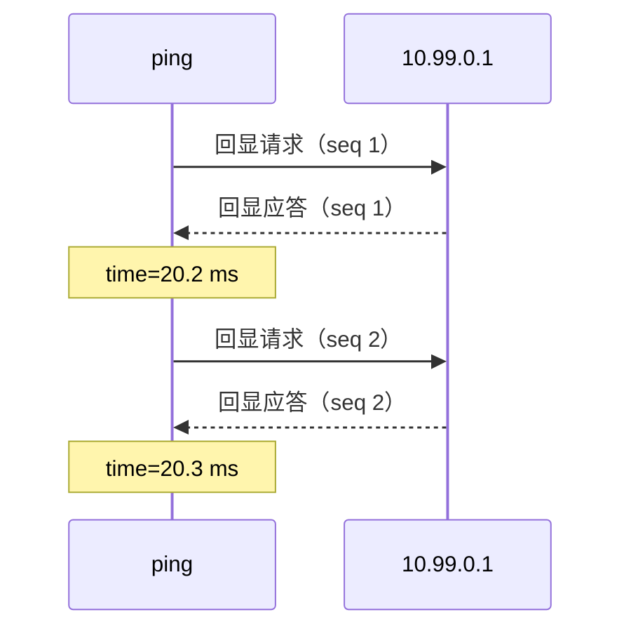
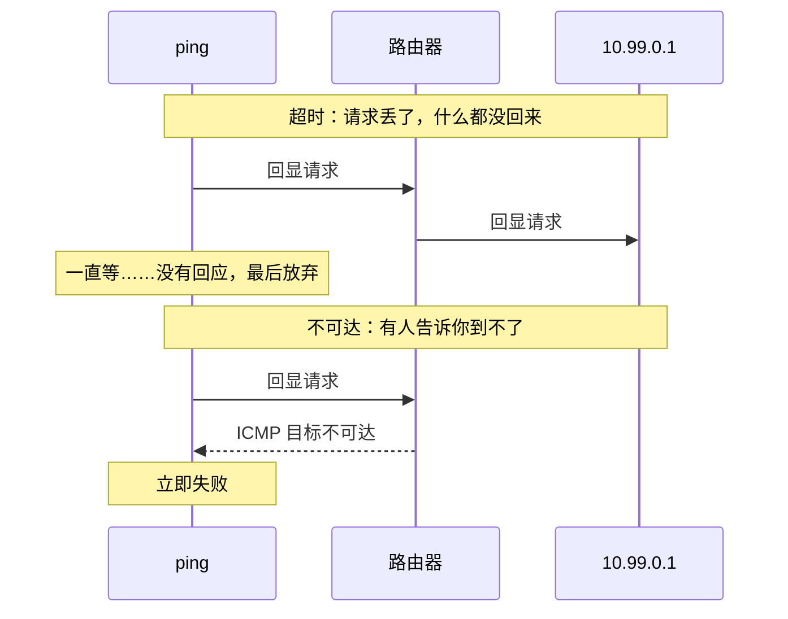
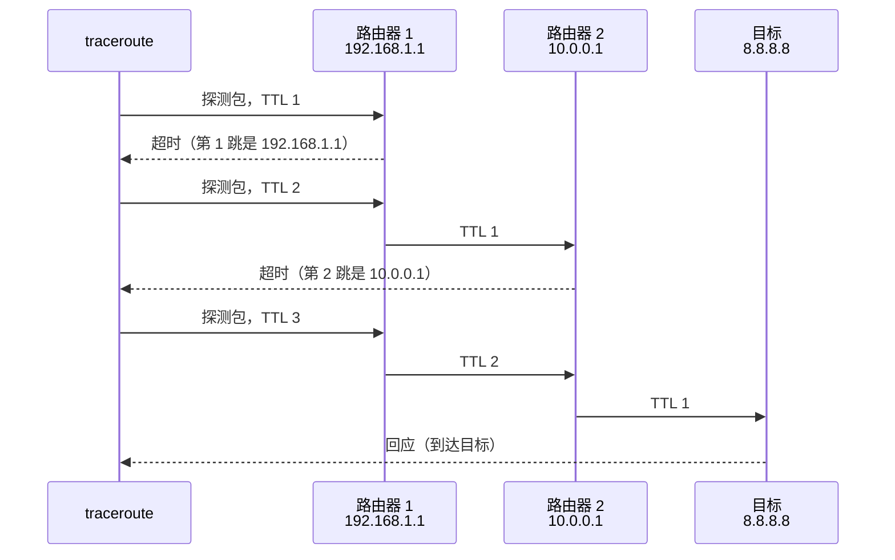
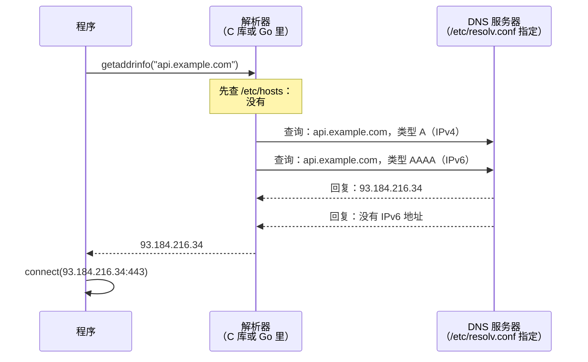

# pingmock 用到的网络基础

[English](basics.md) | 中文

这一页写给会写程序、但从没看过网络数据包内部的读者，讲清楚 pingmock 依赖的网络知识：地址和端口是什么，ping、TCP 连接、DNS 解析实际发了什么，以及 pingmock 怎样插到中间、伪造回应。每一部分最后都说明它和 pingmock 的关系。第一次请按顺序读；以后查最后的[术语表](#术语表)就够了。

读懂这一页之后，[README](../README.zh-CN.md) 讲怎么用 pingmock，[数据包详解](packets.zh-CN.md)逐字节拆解真实的数据包，[代码导读](architecture.zh-CN.md)讲 pingmock 是怎样实现的。

## 1. 地址、网段和端口

网络上的每台机器都有一个 **IP 地址**，比如 `10.99.0.1`（IPv4，四个 0 到 255 的数）或 `fd99::1`（IPv6，更长，用十六进制写）。数据以**数据包**为单位传输，每个数据包都带着它从哪个地址来、到哪个地址去。

**网段**是一段地址，写成起始地址加固定的位数：`10.99.0.0/24` 表示前 24 位（前三个数）固定，也就是 `10.99.0.0` 到 `10.99.0.255`。pingmock 默认用这一段当作假装的主机，没有真实的东西用它。

一台机器上跑着很多程序，光有地址还不知道数据包是给哪个程序的。**端口**是 1 到 65535 的一个数，用来选程序：网页服务器监听 443（HTTPS）或 80（HTTP），PostgreSQL 监听 5432。`10.99.0.1:5432` 就是「10.99.0.1 上的 5432 端口」。

```
             10.99.0.1                 这台机器
   ┌──────────────────────────┐
   │  端口 80    网页服务器    │
   │  端口 5432  数据库        │        机器上的程序
   │  端口 22    SSH           │
   └──────────────────────────┘
```

ping 没有端口：它找的是机器本身。

**和 pingmock 的关系**：规则可以写给地址（`-rule 10.99.0.1=50ms`）、网段（`-rule 10.99.0.0/24=timeout`），TCP 规则还可以写给端口（`-tcp 10.99.0.1:5432=refuse`）。

## 2. 数据包是分层的

一个数据包是一串字节，由一层套一层的部分组成。每一层有一个**头部**，按固定格式排列的几个字节，后面跟着它装的东西：

```
┌─────────────────┬──────────────────────┬────────────────────────┐
│     IP 头部     │  ICMP、TCP 或 UDP    │          数据          │
│     20 字节     │        头部          │     （真正的内容）     │
│ 从哪来、到哪去、│   类型或端口……       │                        │
│ 装的是什么……    │                      │                        │
└─────────────────┴──────────────────────┴────────────────────────┘
```

- **IP 头部**说明数据包从哪来、到哪去、装的是什么：协议号 1 是 ICMP（ping），6 是 TCP，17 是 UDP（DNS 用 UDP）。
- 接下来是这个协议的头部：ICMP 说明是哪种消息，TCP 和 UDP 给出端口。
- 数据是程序发送的内容：网页、数据库查询。

IPv4 头部，按 RFC 的画法，每行 32 位（4 字节）：

```
 0                   1                   2                   3
 0 1 2 3 4 5 6 7 8 9 0 1 2 3 4 5 6 7 8 9 0 1 2 3 4 5 6 7 8 9 0 1
+-------+-------+---------------+-------------------------------+
| 版本  |头部长 |   服务类型    |             总长度            |
+-------+-------+---------------+-----+-------------------------+
|             标识              |标志 |         分片偏移        |
+---------------+---------------+-----+-------------------------+
|      TTL      |    协议号     |           头部校验和          |
+---------------+---------------+-------------------------------+
|                            源地址                             |
+---------------------------------------------------------------+
|                           目的地址                            |
+---------------------------------------------------------------+
```

这里要关心的字段：**协议号**（后面跟着什么）、**源地址**和**目的地址**，以及 **TTL**：每经过一台路由器减一的计数器，traceroute 靠它工作（第 6 节）。

**和 pingmock 的关系**：pingmock 读取发往它模拟的地址的每个数据包，看这些头部来识别 ping 和连接请求，再逐字节构造回应写回去。[数据包详解](packets.zh-CN.md)用真实的数据包演示了这个过程。

## 3. ping：ICMP 回显

`ping 10.99.0.1` 发出一个**回显请求**（echo request，一条很小的 ICMP 消息），那个地址上的机器回一个**回显应答**（echo reply）。ping 测量两者之间的时间：**往返时间**，也就是延迟。



IP 头部之后的 ICMP 回显消息：

```
 0                   1                   2                   3
 0 1 2 3 4 5 6 7 8 9 0 1 2 3 4 5 6 7 8 9 0 1 2 3 4 5 6 7 8 9 0 1
+---------------+---------------+-------------------------------+
|     类型      |     代码      |             校验和            |
|   8 = 请求    |       0       |                               |
|   0 = 应答    |               |                               |
+---------------+---------------+-------------------------------+
|            标识符             |              序号             |
+-------------------------------+-------------------------------+
|  数据：ping 把发出请求的时间写在这里，应答原样带回来          |
+---------------------------------------------------------------+
```

描述网络回应好坏的三个词：

- **延迟**：往返一次要多久。20ms 是附近的服务器，300ms 是地球另一边或者很差的线路。
- **抖动**：延迟每次之间变化多大。
- **丢包**：有多大比例的请求得不到回应。ping 显示为 `10% packet loss`。

**和 pingmock 的关系**：`delay=50ms,jitter=10ms,loss=5%` 这样的规则为一个目标设定这三项。pingmock 自己回应每个请求，在延迟之后回复，或者丢掉它；数据原样带回，所以 ping 自己测出来的就是你设定的延迟。

## 4. 没有回应时：超时和不可达

一个请求可以有两种完全不同的失败方式，程序往往会区别对待：



- **超时**：什么都没回来。程序一直等到放弃，往往要几秒。机器宕机、防火墙悄悄丢弃，看起来就是这样。
- **不可达**：路由器或目标本身回一个 ICMP 错误（「目标不可达」，ICMP 类型 3）。程序立刻就知道，不用等。原因有几种：主机不可达、网络不可达、被管理员禁止（防火墙拒绝）。

**和 pingmock 的关系**：`timeout` 或 `loss=` 是前一种，`unreachable[=host|net|admin]` 是后一种。详见 README 的[不可达与超时](../README.zh-CN.md#不可达与超时)。

## 5. TCP 连接

大多数程序不 ping，而是**建立连接**：连数据库、网页服务器、API。TCP 就是做这个的协议，一个连接从**三次握手**开始：


SYN、ACK、FIN、RST 是**标志位**：TCP 头部里的单个比特，说明这个报文是什么。TCP 头部：

```
 0                   1                   2                   3
 0 1 2 3 4 5 6 7 8 9 0 1 2 3 4 5 6 7 8 9 0 1 2 3 4 5 6 7 8 9 0 1
+-------------------------------+-------------------------------+
|            源端口             |            目的端口           |
+-------------------------------+-------------------------------+
|                             序号                              |
|          （给发出的字节编号；起点随机，称为 ISN）             |
+---------------------------------------------------------------+
|                            确认号                             |
|                  （期待对方发来的下一个字节）                 |
+-------+-------+---------------+-------------------------------+
| 数据  |       |C E U A P R S F|                               |
| 偏移  |       |W C R C S S Y I|              窗口             |
|       |       |R E G K H T N N|       （还能接收多少数据）    |
|       |       |    标志位     |                               |
+-------+-------+---------------+-------------------------------+
|            校验和             |            紧急指针           |
+-------------------------------+-------------------------------+
|              选项（MSS、时间戳……），然后是数据                |
+---------------------------------------------------------------+
```

连接失败的方式比 ping 多：

| 发生了什么 | 程序看到的 |
|---|---|
| SYN 没有回应 | `connect` 等一阵后超时：「connection timed out」 |
| 服务器用 **RST**（重置）回应 SYN，端口上没有程序监听时就是这样 | `connect` 立即失败：「connection refused」（`ECONNREFUSED`） |
| 回来一个 ICMP 不可达错误 | `connect` 立即失败：「no route to host」 |
| 连接建立了，服务器却什么都不发 | 读取超时：连接开着，但没有声音 |
| 连接建立后，服务器关闭了它（**FIN**） | 读到文件结束；HTTP 客户端报空回复 |
| 连接建立后，服务器重置了它（**RST**） | 「connection reset by peer」（`ECONNRESET`） |

**和 pingmock 的关系**：TCP 规则为每个地址和端口选其中一种：`5ms` 在 5ms 后接受，`refuse` 回 RST，`timeout` 不回应，`unreachable` 回 ICMP 错误，`after=hang|close|reset` 决定连接建立之后怎样。pingmock 并不运行服务器：它自己写出 SYN-ACK、RST 或 FIN，握手的其余部分由程序自己的内核完成。见 [TCP 连接](../README.zh-CN.md#tcp-连接)。

## 6. traceroute：TTL 和跳

你和服务器之间有**路由器**，每台把数据包往前传一步，每一步叫一**跳**。每台路由器把数据包的 **TTL** 减一，减到 0 时就丢掉它，并从自己的地址回一个 ICMP **超时**错误（time exceeded）。traceroute 故意利用这一点：先发 TTL 为 1 的包，再发 2、3……每台路由器依次暴露出来。



**和 pingmock 的关系**：路径（`-path '8.8.8.8=192.168.1.1@2ms > 10.0.0.1@15ms'`）凭空造出这些路由器：pingmock 替 TTL 耗尽处的那台路由器回应每个探测包。见[路径](../README.zh-CN.md#路径traceroute-和-mtr)。

## 7. DNS：从域名到地址

程序很少直接用地址，而是用 `api.example.com` 这样的域名。连接之前，程序要**解析**域名：问 **DNS 服务器**这个域名对应哪个地址。



- **解析器**是 C 库（或 Go）里替程序做这件事的部分。它先读 `/etc/hosts`，一个写死了域名和地址的文件，再去问 `/etc/resolv.conf` 里指定的 DNS 服务器。
- 它通常同时查 IPv4 地址（**A 类型**）和 IPv6 地址（**AAAA 类型**）。
- 查询通常走 UDP 的 53 端口。DNS 消息是 12 字节的头部（ID、标志、回复码和几个计数），然后是问题，然后是回答：

```
+--------------------------------------+
| 头部（12 字节）                      |
|   ID、标志、RCODE（回复码）、        |
|   问题和回答的个数                   |
+--------------------------------------+
| 问题：域名和类型                     |
|   api.example.com，类型 A            |
+--------------------------------------+
| 回答：域名、类型、TTL、地址          |
|   api.example.com A 93.184.216.34    |
+--------------------------------------+
```

回复码说明结果如何：

| 回复 | 程序看到的 |
|---|---|
| 一个地址 | 解析成功 |
| **NXDOMAIN**：域名不存在 | 立即失败：「Name or service not known」 |
| **SERVFAIL**：服务器出错 | 解析器重试，然后：「Temporary failure in name resolution」 |
| 没有回复 | 解析器等待（默认 5 秒）、重试，然后和 SERVFAIL 一样失败 |

**和 pingmock 的关系**：在 `pingmock exec` 下，命令拿到自己的 `/etc/hosts` 和 `/etc/resolv.conf`，指向 pingmock 为它运行的一个小 DNS 服务。所以规则可以写给域名（`-rule api.example.com=80ms`），DNS 规则也能让一个域名解析失败（`-dns api.example.com=nxdomain`）。见[域名](../README.zh-CN.md#域名)和 [DNS 故障](../README.zh-CN.md#dns-故障)。

## 8. pingmock 怎样插到中间

内核用**路由表**决定每个数据包往哪走：「这一段地址从那块网卡出去」。pingmock 创建一块**虚拟网卡**，一个名叫 `pingmock0` 的 TUN 设备，并加上路由，让它模拟的地址都走这块网卡。TUN 设备后面没有网线：内核发给它的每个数据包都由一个程序读走，这个程序写入的每个数据包又回到内核，就像从网络上收到的一样。


所以程序不需要任何改动：它照常 ping、照常连接，内核把数据包交给 pingmock，pingmock 写回你设定的回应。[一个 ping 的往返之旅](packet-path.zh-CN.md)一步步跟着一个数据包走过内核。

有两种运行方式：

- **`sudo pingmock`** 修改整台机器的路由，所以需要 root（管理员）权限，机器上所有程序都会看到模拟的地址。
- **`pingmock exec -- ./my-app`** 不需要 root：它给命令一份私有的网络，即**网络命名空间**，有自己的网卡和路由。只有这个命令看到模拟的网络，机器上什么都不会改变。

## 术语表

| 词 | 含义 |
|---|---|
| **IP 地址** | 机器的地址：`10.99.0.1`（IPv4）或 `fd99::1`（IPv6） |
| **网段**、**前缀**、**CIDR** | 一段地址：`10.99.0.0/24` 是 `10.99.0.0` 到 `10.99.0.255` |
| **端口** | 机器上的哪个程序：HTTPS 是 443，PostgreSQL 是 5432 |
| **数据包** | 网络上的一个数据单位：头部，然后是数据 |
| **头部** | 数据包或某一层开头、按固定格式排列的字节 |
| **ICMP** | ping 和网络错误消息用的协议 |
| **回显请求 / 应答** | ping 的提问和回答 |
| **延迟**、**往返时间** | 请求要多久才回来 |
| **抖动** | 延迟变化多大 |
| **丢包** | 得不到回应的请求所占的比例 |
| **超时** | 等不到回应，最后放弃 |
| **不可达** | 说明目标到不了的 ICMP 错误 |
| **TCP** | 连接用的协议：网页、数据库、大多数 API |
| **握手**、**SYN**、**SYN-ACK**、**ACK** | 建立 TCP 连接的三个报文 |
| **RST**、**重置** | 中止连接；作为 SYN 的回应时就是「connection refused」 |
| **FIN** | 正常关闭连接 |
| **UDP** | 没有连接的协议，DNS 用它 |
| **TTL**、**跳** | 路由器每次减一的计数器；路上的每一台路由器 |
| **traceroute**、**mtr** | 列出到目标路上每台路由器的工具 |
| **DNS**、**解析** | 把域名变成地址 |
| **解析器** | 程序所用的库中负责解析域名的部分 |
| **A**、**AAAA** | DNS 中 IPv4 地址和 IPv6 地址的类型 |
| **NXDOMAIN**、**SERVFAIL** | DNS 的回复：域名不存在；服务器出错 |
| **`/etc/hosts`**、**`/etc/resolv.conf`** | 写死的域名；去问哪个 DNS 服务器 |
| **路由表** | 内核记录每段地址往哪走的表 |
| **网卡**（网络接口） | 数据包离开机器的地方：`eth0`、`wlan0`、`pingmock0` |
| **TUN 设备** | 一块虚拟网卡，它的数据包由程序读写 |
| **网络命名空间** | 给一些进程用的一份私有网络 |
| **root** | Linux 的管理员账户 |
| **mock**（模拟） | 一个替身，给出测试决定好的回答 |
| **种子**（seed） | 让随机选择每次都一样重复的一个数 |
