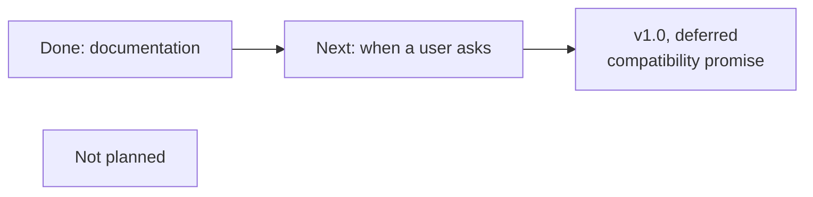

# Technical roadmap

English | [中文](roadmap.zh-CN.md)

Where pingmock stands after v0.14.0, what comes next, and why, as of 23 October 2026. The steps, with what was verified at each one, are tracked in [TODO.md](../TODO.md#通往-v10) (in Chinese). The evidence behind this page, including the competitor analysis, is in [planning, round seven](planning.md#a-seventh-round-competitors-and-direction-after-v10-23-october-2026).

The common protocols are now supported, and the documentation stage is done. The v1.0 compatibility promise is deferred: the project is still in internal development, so changes need not stay compatible (the maintainer, 23 October 2026). A new feature waits until a user asks for it, and features are ordered by the number of users they serve. Of the 34 competitors studied, none keeps all four [core values](../CONTRIBUTING.md#design-principles): transparent, per target, reproducible, and controllable and observable.

## What is done

| Version | What it added |
|---|---|
| up to v0.8 | ICMP and ICMPv6 echo; paths for traceroute and mtr |
| v0.9, v0.10 | TCP connections: accepted, refused or unanswered, then closed or reset (`after=`) |
| v0.11 | DNS failures under `pingmock exec`: NXDOMAIN, SERVFAIL, timeout |
| v0.12 | Fixed bytes on TCP connections: `send=`, `reply=`, `limit=`, `wait=` |
| v0.13 | `-udp`: port unreachable, other unreachable errors, timeout |
| v0.14 | Cleanup before the freeze: exit status 125, DNS event fields, fuzzing |

## The stages

### Done: outside access for `exec`

The maintainer chose it first among the items below, since it serves the largest group, application developers. `pingmock exec -outside` gives the command the host's network through pasta, and `-outside-port 5432` its host's loopback port, while mocked targets keep their rules ([README](../README.md#outside-access)). Implemented on 23 October 2026, not released yet.

### Done: documentation, no release

Done on 23 October 2026, in both languages.

- What is left of item 1 in TODO.md: QUIC falling back to TCP under "when to use something else", and UDP replies with content and QUIC fallback under "not planned".
- **Probes bound to an interface.** `ping -I <address>` and `ping -I pingmock0` reach pingmock today. A probe bound to a real device, such as `ping -I eth0` or mwan3's wrapper, does not. It reaches pingmock once pingmock's prefix is added to that probe's routing table, or with a `tc` mirred redirect. Both were verified in the development container.
- Check off the items in TODO.md that were decided but not marked.
- The README's Docker section says that the API has no authentication, and to publish it on loopback only.

### Next: when a user asks

These are ordered by the number of users they would serve, but none starts without a user asking.

| Direction | For | State |
|---|---|---|
| Rules per interface or source address (multi-WAN, mwan3) | operations staff | Designed. The experiment works, also without root inside `exec`. Medium cost: `rule`, `engine`, `tun`, `app`, `api`, `client` |
| Python client, standard library only, with a pytest fixture | application developers | Toxiproxy has clients in 10 languages. Lowest priority: the API may still change |
| Testcontainers module | application developers | Useful only when the code under test runs in a container |
| Replace the `ip` command with netlink | everyone | Removes the runtime dependency on iproute2 |
| ICMP Packet Too Big, DNS in root mode, records other than A/AAAA, replaying recorded latency | — | No evidence of users yet |

### v1.0: the compatibility promise, deferred

About one day, in both languages, once the project leaves internal development. Until then nothing is frozen. The image keeps `-api 0.0.0.0:9100`, so that `-p` works, and the README says to publish the port on loopback only.

What the promise would cover:

- **Frozen:** flags and their defaults, the rule text, YAML keys and JSON, API paths, methods and status codes, event fields and result words, the `client` package (additions only), seeded sequences, exit statuses, `PINGMOCK_API`, default addresses.
- **Not frozen:** the `-v` log, error messages, the order of keys, `internal/`.

### Not planned

| Direction | Why |
|---|---|
| General traffic shaping | netem and Toxiproxy do it well. pingmock fakes answers; it does not change the real network |
| HTTP-level faults | WireMock, Hoverfly and MockServer cover them, and fixed bytes already give a server that answers 503 |
| Native macOS or Windows | `exec` depends on Linux namespaces. Competitors on macOS need root, and their per-target filtering breaks ([comcast #82](https://github.com/tylertreat/comcast/issues/82)). macOS users run pingmock in Docker, as Pumba's do |
| UDP replies with content (NTP, SNMP, QUIC) | That is simulating a service |
| QUIC falling back to TCP | pingmock takes over the whole address, so it cannot fail UDP while TCP reaches the real server |
| A GitHub Action | None exists for netem either; [the workflow example](../examples/github-actions) is enough |
| IPv6 extension headers, an `LD_PRELOAD` shim | No evidence; a C library is against the dependency policy |

## How the competitors compare

| Route | Examples | Transparent | Per target | Reproducible | Control and history | Root |
|---|---|---|---|---|---|---|
| **TUN and routes** | **pingmock** | **yes** | **yes** | **yes** | **yes** | **not under `exec`** |
| TCP and HTTP proxies (10) | Toxiproxy, WireMock, Hoverfly, trixter | no | per proxy | mostly no | partly | no |
| tc, netem and iptables (7) | Comcast, tcconfig, Pumba, clumsy | yes | partly | no seed found | command line only | yes |
| Kubernetes chaos platforms (6) | Chaos Mesh, Litmus, ChaosBlade | per pod | yes | no seed found | partly | cluster privileges |
| DNS servers with faults (2) | CoreDNS `erratic`, Pakomo | no | per zone | 1 in N | no | no |
| TUN or raw sockets answering ICMP (6) | Trippy's simulator, pong, fakert | yes | per hop | ? | no | yes |
| In-process simulated networks (3, new in 2025–26) | netchaos, gosimnet, godst | needs a `Dial` hook | partly | yes | yes | no, Go only |

"No seed found" means none was found in the README or the documentation, which is not proof that there is none. The full list, with stars, sources and four more reference projects, is in [planning, round seven](planning.md#a-seventh-round-competitors-and-direction-after-v10-23-october-2026).

## Where pingmock is behind

| Gap | Competitors | What the roadmap does |
|---|---|---|
| Platforms | Toxiproxy runs on Windows and macOS; clumsy covers Windows | Not planned; Docker on macOS |
| Client languages | Toxiproxy has 10 | Python, when a user asks |
| Test frameworks | testcontainers-go has a Toxiproxy module | Waits for a user |
| Protocol depth | HTTP mocks match requests and know the protocol | Not planned; fixed bytes cover a server that answers 503 |
| Multi-WAN probes | Tools shape traffic per interface; none fakes answers per interface | Designed, waits for an operations user |

## Not known yet

- pingmock has no user feedback yet: no issues, no pull requests.
- Not verified: the real mwan3 wrapper, IPv6, TCP and UDP through the redirect, the effect of `rp_filter=1`.
- Not researched: dnsmasq tricks, test harnesses built on pasta, test helpers that run tc and netem in a namespace, GitHub Discussions.
