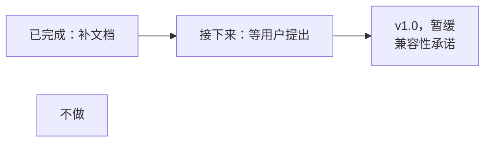

# 技术路线图

[English](roadmap.md) | 中文

v0.14.0 之后 pingmock 处在什么位置、接下来做什么、为什么，截至 2026 年 10 月 23 日。每一步的进度和验证记录在 [TODO.md](../TODO.md#通往-v10)。这一页依据的证据，包括竞品分析，见[规划的第七轮](planning.zh-CN.md#第七轮竞品和-v10-之后的方向2026-年-10-月-23-日)。

常用协议已经支持完整，补文档的阶段也做完了。v1.0 的兼容性承诺暂缓：项目还在内部开发阶段，改动不必保持兼容（维护者，2026 年 10 月 23 日）。新功能都要等用户提出需求再做，并按用户数量排序。调研的 34 个竞品里，没有一个能同时满足四个[核心价值](../CONTRIBUTING.md#design-principles)：透明、按目标、可复现、可控制且可观察。

## 已完成

| 版本 | 新增的内容 |
|---|---|
| v0.8 及以前 | ICMP 和 ICMPv6 echo；traceroute、mtr 的路径 |
| v0.9、v0.10 | TCP 连接：接受、拒绝或不回应，之后关闭或重置（`after=`） |
| v0.11 | `pingmock exec` 下的 DNS 故障：NXDOMAIN、SERVFAIL、超时 |
| v0.12 | 在 TCP 连接上发送固定的字节：`send=`、`reply=`、`limit=`、`wait=` |
| v0.13 | `-udp`：端口不可达、其他不可达错误、超时 |
| v0.14 | 冻结前的整理：退出码 125、DNS 事件字段、fuzz 测试 |

## 几个阶段

### 已完成：补文档，不发版

2026 年 10 月 23 日完成，中英文。

- TODO.md 第 1 项剩下的部分：「什么时候用别的」加上 QUIC 回退到 TCP，「不做」加上带内容的 UDP 回复和 QUIC 回退。
- **绑定网卡的探测。** `ping -I <地址>` 和 `ping -I pingmock0` 现在就能到达 pingmock。绑定到真实网卡的探测到不了，比如 `ping -I eth0` 或 mwan3 的封装。把 pingmock 的网段加进这个探测用的路由表，或者用 `tc` mirred 重定向，就能到达。两种做法都在开发容器里验证过。
- TODO.md 里已经定了、还没打勾的几项打上勾。
- README 的 Docker 一节写明 API 没有认证，端口只映射到本机地址。

### 接下来：等用户提出

按服务的用户数量排序，但没有用户提出就不开始。

| 方向 | 用户 | 状况 |
|---|---|---|
| 按网卡或源地址区分的规则（多 WAN、mwan3） | 运维人员 | 设计已有。实验可行，在 `exec` 里不需要 root 也行。工作量中等：`rule`、`engine`、`tun`、`app`、`api`、`client` |
| `exec` 访问外网，借助 pasta 或 slirp4netns | 应用开发者 | 让被测命令能下载依赖、访问真实服务 |
| Python 客户端，只用标准库，附带 pytest fixture | 应用开发者 | Toxiproxy 有 10 种语言的客户端。优先级最低：API 还可能改 |
| Testcontainers 模块 | 应用开发者 | 只在被测代码运行在容器里时有用 |
| 用 netlink 替代 `ip` 命令 | 所有人 | 去掉运行时对 iproute2 的依赖 |
| ICMP Packet Too Big、root 模式下的 DNS、A/AAAA 以外的记录、回放录下的延迟 | — | 还没有用户的证据 |

### v1.0：兼容性承诺，暂缓

约一天，中英文，等项目结束内部开发阶段再做。在那之前什么都不冻结。镜像保留 `-api 0.0.0.0:9100`，这样 `-p` 才能用，README 提醒端口只映射到本机地址。

承诺会覆盖的范围：

- **冻结：** 参数及默认值、规则文本、YAML 键和 JSON、API 的路径、方法和状态码、事件字段和结果用词、`client` 包（只增不改）、seed 序列、退出码、`PINGMOCK_API`、默认地址。
- **不冻结：** `-v` 的日志、错误信息、键的顺序、`internal/`。

### 不做

| 方向 | 原因 |
|---|---|
| 通用的流量整形 | netem 和 Toxiproxy 已经做得很好。pingmock 伪造回应，不改变真实的网络 |
| HTTP 层的故障 | WireMock、Hoverfly、MockServer 已经覆盖；固定的字节已经能让服务器回 503 |
| 原生支持 macOS 或 Windows | `exec` 依赖 Linux 命名空间。macOS 上的竞品需要 root，按目标过滤也有问题（[comcast #82](https://github.com/tylertreat/comcast/issues/82)）。macOS 用户在 Docker 里运行 pingmock，Pumba 的用户也是这样 |
| 带内容的 UDP 回复（NTP、SNMP、QUIC） | 等于模拟服务 |
| QUIC 回退到 TCP | pingmock 接管整个地址，没法只让 UDP 失败、TCP 通向真实服务器 |
| GitHub Action | netem 也没有；[workflow 示例](../examples/github-actions)已经够用 |
| IPv6 扩展头、`LD_PRELOAD` 垫片 | 没有证据；C 库违反依赖原则 |

## 和竞品比较

| 路线 | 代表项目 | 透明 | 按目标 | 可复现 | 控制和历史 | 需要 root |
|---|---|---|---|---|---|---|
| **TUN 和路由** | **pingmock** | **是** | **是** | **是** | **是** | **`exec` 下不需要** |
| TCP 和 HTTP 代理（10 个） | Toxiproxy、WireMock、Hoverfly、trixter | 否 | 按代理 | 大多没有 | 部分 | 不需要 |
| tc、netem 和 iptables（7 个） | Comcast、tcconfig、Pumba、clumsy | 是 | 部分 | 未见 seed | 只有命令行 | 需要 |
| Kubernetes 混沌平台（6 个） | Chaos Mesh、Litmus、ChaosBlade | 按 Pod | 是 | 未见 seed | 部分 | 需要集群权限 |
| 带故障的 DNS 服务（2 个） | CoreDNS `erratic`、Pakomo | 否 | 按 zone | 每 N 个一次 | 否 | 不需要 |
| 用 TUN 或原始套接字回 ICMP（6 个） | Trippy 的模拟器、pong、fakert | 是 | 按跳 | ? | 否 | 需要 |
| 进程内模拟网络（3 个，2025–26 年新出） | netchaos、gosimnet、godst | 要接入 `Dial` | 部分 | 是 | 是 | 不需要，只支持 Go |

「未见 seed」指在 README 和文档里没找到，不能证明没有。完整的列表，包括星数、来源和另外 4 个参考项目，见[规划的第七轮](planning.zh-CN.md#第七轮竞品和-v10-之后的方向2026-年-10-月-23-日)。

## pingmock 落后在哪里

| 差距 | 竞品 | 路线图怎么做 |
|---|---|---|
| 平台 | Toxiproxy 能在 Windows 和 macOS 上运行；clumsy 覆盖 Windows | 不做；macOS 上用 Docker |
| 客户端语言 | Toxiproxy 有 10 种 | 有用户提出时做 Python |
| 测试框架 | testcontainers-go 里有 Toxiproxy 模块 | 等用户提出 |
| 协议深度 | HTTP mock 能匹配请求、理解协议 | 不做；固定的字节够用来模拟回 503 的服务器 |
| 多 WAN 探测 | 有按网卡整形流量的工具，没有按网卡伪造回应的 | 设计已有，等运维用户提出 |

## 还不知道的

- pingmock 还没有用户反馈：没有 issue，也没有 pull request。
- 没有验证：真实的 mwan3 封装、IPv6、TCP 和 UDP 经过重定向后的表现、`rp_filter=1` 的影响。
- 没有调研：dnsmasq 的技巧、基于 pasta 的测试框架、在命名空间里运行 tc 和 netem 的测试辅助工具、GitHub Discussions。
